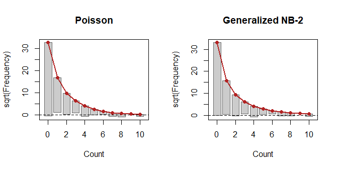
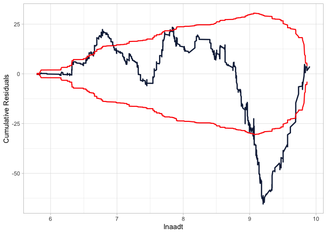
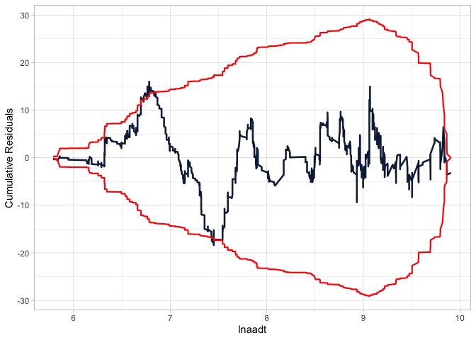
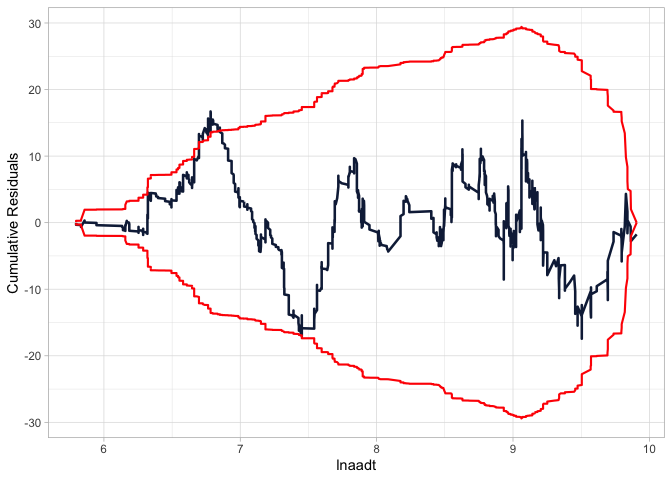

<!-- README.md is generated from README.Rmd. Please edit that file -->

# flexCountReg 

<!-- badges: start -->

[](https://app.codecov.io/gh/jwood-iastate/flexCountReg)
<!-- badges: end -->

The goal of flexCountReg is to provide functions that allow the analyst
to estimate count regression models that can handle multiple analysis
issues, including:

- many count distributions beyond the Poisson and negative binomial (see
  the list below), with any distribution parameter modeled as a function
  of variables (generalized count models);
- your own count distributions, defined from a log probability function
  with `new_count_family()` and usable in every model;
- underreporting, and zero-inflated or hurdle versions of every
  distribution;
- random parameters, with heterogeneity in their means and variances,
  analytic gradients, separate simulation draws for each panel, and
  exact, simulated and Empirical Bayes (observation-specific)
  predictions;
- random-effects panel models (negative binomial, Poisson-Lindley,
  negative multinomial) and fixed-effects models (`countreg_fe()`:
  Poisson with any number of fixed-effect dimensions, or any family with
  one);
- finite mixtures and latent-class count regressions, with constant,
  covariate-dependent or known class proportions, shared or
  class-specific parameters, different families in different classes,
  and one class per panel;
- inference with Hessian-based, robust, cluster-robust (one-way or
  multiway) or bootstrap standard errors, frequency or sampling weights,
  and methods for the sandwich and lmtest packages;
- model comparison and diagnostics: likelihood-ratio tests, comparison
  tables, marginal effects, CURE plots, rootograms and randomized
  quantile residuals;
- an interactive app (`launch_app()`) for the whole workflow, from data
  to a downloadable R script that reproduces the analysis.

Fitted models work with the standard R generics (`coef()`, `vcov()`,
`AIC()`, `BIC()`, `confint()`, `predict()`, `simulate()`, `update()`,
…), with `tidy()`, `glance()` and `augment()`, and with tidymodels
through the `count_reg()` parsnip model.

## Installation

You can install the development version of flexCountReg using:

``` r
# install.packages("devtools")
devtools::install_github("jwood-iastate/flexCountReg")
```

## Interactive app

flexCountReg includes an interactive app for analysts who prefer to work
without writing code, and for anyone who wants a quick way to explore
models before scripting them. Start it from R:

``` r
library(flexCountReg)
launch_app()
```

The app opens in a web browser, with one tab for each step of an
analysis:

- **Data**: load one of the example datasets or a CSV file, inspect the
  columns and missing values, and create new variables (logs, powers,
  standardized values, indicators, products, ratios, categories and
  factors).
- **Build**: choose the model (count regression, random parameters,
  random-effects panel models, finite mixtures or latent classes), the
  count distribution, response, predictors, interactions between
  predictors, exposure or offset, frequency weights and panel
  identifier, and the model-specific options. The draft is checked
  before it can be estimated.
- **Fit**: models are estimated in the background, so the app stays
  responsive and long fits can be canceled. The tab shows the summary,
  coefficients, marginal effects (or elasticities) with standard errors,
  numerical checks (convergence, gradient, conditioning of the
  information matrix) and, for mixtures, class sizes and starts.
- **Diagnose**: rootograms, randomized quantile residuals and CURE plots
  for any of the fitted models, with the plots saved as JPEG files at
  the size and resolution you choose (for papers and reports).
- **Compare**: log-likelihood, AIC and BIC of several fits, with a
  warning when they are not comparable (different rows, responses or
  units).
- **Predict**: expected counts, confidence or prediction intervals, and
  tolerance intervals for an editable table of scenarios or for a CSV
  file of new data; variables you created on the Data tab are created in
  the new data the same way.
- **Export**: download the analysis.

Everything the app runs is also written as R code. The *R code* panel at
the bottom shows the session script: the data loading, every new
variable, every fit, diagnostic, prediction and comparison, in the order
they ran, using the package’s own functions (`countreg()`,
`countreg_rp()`, `rootogram()`, `tolerance_interval()`, …). The app
evaluates exactly this code, and the Export tab downloads it as
`analysis.R` together with the settings of each fit and a manifest of
versions and warnings, so the analysis can be rerun, modified and shared
without the app. For example, a session that loads data, adds a variable
and fits a model produces code like:

``` r
data_1 <- local({
    env <- new.env()
    utils::data(list = "washington_roads", package = "flexCountReg", envir = env)
    env[["washington_roads"]]
})
data_1[["aadt10k"]] <- as.integer(data_1[["AADT"]] > 10000)
fit_1 <- flexCountReg::countreg(formula = Total_crashes ~ lnaadt + aadt10k + 
    offset(log(Length)), data = data_1, family = "NB2", method = "BFGS", 
    max.iters = 1000L)
fit_1_summary <- summary(fit_1)
```

The app uses the shiny, bslib, DT, callr, jsonlite and zip packages,
which are suggested rather than required by flexCountReg; `launch_app()`
offers to install any that are missing. Uploaded data stay on your
computer.

## Functions and Data

**Model Estimation Functions**

- `countreg()` estimates cross-sectional count regression models with
  any of the distributions below, optional models for the distribution
  parameters, underreporting, and zero-inflated or hurdle zero models,
  with Hessian-based, robust, cluster-robust (`cluster = ~ site`) or
  bootstrap standard errors.
- `countreg_rp()` estimates random parameters count models, optionally
  with panels, correlated random parameters, and heterogeneity in the
  means and variances of the random parameters. Fits use the analytic
  gradient of the simulated likelihood and, by default, separate Halton
  draws for each panel.
- `countreg_mix()` and `countreg_lc()` estimate finite-mixture and
  latent-class count models (the same engine under two vocabularies),
  with several reproducible starts, and `component_probs()` /
  `class_probs()` give prior or posterior class probabilities.
- `countreg_fe()` estimates fixed-effects count models: Poisson by the
  conditional likelihood (one dimension) or IRLS with alternating
  projections (site and year, …), and any other family, including
  user-defined ones, by the concentrated dummy-variable likelihood, with
  an optional split-panel jackknife. Standard errors are cluster-robust
  by default; estimates equal those of `fixest::fepois()` and
  `fixest::fenegbin()`.
- `cre = ~ x` in `countreg_rp()`, `renb()` and `repois()` adds the means
  of time-varying regressors within each unit (correlated random
  effects, Mundlak 1978), and `cre_test()` tests random against fixed
  effects.
- `renb()` estimates the random effects negative binomial regression
  model.
- `poisLind.re()` (also `poislind_re()`) estimates the random effects
  Poisson-Lindley model.
- `negmultinom()` estimates negative multinomial (random effects) panel
  models (NM1, NM2 and NM-P).
- `repois()` estimates the random effects Poisson model with a gamma
  random effect.
- `new_count_family()` defines a count distribution from its log
  probability function (with optional mean, variance, CDF and
  random-draw functions) for use as `family` in `countreg()`,
  `countreg_rp()`, `countreg_mix()` and `countreg_lc()`;
  `check_count_family()` tests it numerically. See
  `vignette("user-defined-count-distributions", package = "flexCountReg")`.
- `count_reg()` is a [parsnip](https://parsnip.tidymodels.org/) model
  specification with a `"flexCountReg"` engine, for use with tidymodels
  (the distribution can be tuned with `count_family()`).

**Working with Fitted Models**

- `summary()` gives the coefficient table, standard-error type, fit
  statistics and a likelihood-ratio test against the Poisson model.
- `predict()` gives expected counts (one per row of `newdata`, `NA` for
  incomplete rows), the probability of each count, and the components of
  underreporting and zero models. For `countreg()` models it also gives
  confidence intervals for the expected count and prediction intervals
  for a new count (`interval = "confidence"` or `"prediction"`). For
  random parameters models it offers exact, simulated and Empirical
  Bayes (`"Individual"`) predictions.
- `tolerance_interval()` gives content tolerance intervals for
  `countreg()` models: count ranges intended to contain at least a
  stated share of the outcome distribution with a stated confidence.
- `coef()`, `vcov()`, `confint()`, `logLik()`, `AIC()`, `BIC()`,
  `nobs()`, `fitted()`, `residuals()` (response, Pearson and randomized
  quantile), `simulate()` and `update()` work as for other R models.
- `vcov(m, type = "cluster", cluster = ~ corridor)` recomputes
  cluster-robust (one-way or multiway) covariances after the fit,
  without refitting; `type = "robust"` and `"hessian"` are also
  available. `estfun()` and `bread()` methods let `sandwich::vcovCL()`,
  `sandwich::vcovHC()` and `lmtest::coeftest()` work with flexCountReg
  models.
- `tidy()`, `glance()` and `augment()` return tibbles in the broom
  format.

**Model Evaluation, Comparison, and Convenience Functions**

- `regCompTest()` compares a model with a base model, or two fitted
  models, with a likelihood ratio test, AIC, BIC and McFadden’s pseudo
  R-squared.
- `regCompTable()` creates a publication-ready table comparing multiple
  models.
- `margEffTable()` computes marginal effects (or elasticities) with
  delta-method or bootstrap standard errors.
- `cureplot()` generates a CURE plot for the specified model, based on
  the [cureplots package](https://gbasulto.github.io/cureplots/).
- `rootogram()` compares observed and expected count frequencies.
- `mae()` and `rmse()` compute the mean absolute error and root mean
  squared error; `myAIC()` and `myBIC()` compute AIC and BIC from a
  log-likelihood.
- `halton_dists()`, `corr_haltons()` and `cor2cov()` generate
  (correlated) Halton draws and convert correlation matrices to
  covariance matrices.

**Distribution Functions**

Density (`d`), distribution (`p`), quantile (`q`) and random generation
(`r`) functions are provided for each distribution:

*Count distributions*

- Conway-Maxwell-Poisson (COM): `dcom`, `pcom`, `qcom`, `rcom`
- Delaporte: `ddelaporte`, `pdelaporte`, `qdelaporte`, `rdelaporte`
- Discrete Weibull: `ddweib`, `pdweib`, `qdweib`, `rdweib`
- Double Poisson: `ddpo`, `pdpo`, `qdpo`, `rdpo`
- Gamma Count: `dgcount`, `pgcount`, `qgcount`, `rgcount`
- Generalized Hermite: `dghermite`, `pghermite`, `qghermite`,
  `rghermite`
- Generalized Poisson Version 1: `dgp1`, `pgp1`, `qgp1`, `rgp1`
- Generalized Poisson Version 2: `dgp2`, `pgp2`, `qgp2`, `rgp2`
- Generalized Waring: `dgwar`, `pgwar`, `qgwar`, `rgwar`
- Hyper-Poisson: `dhpois`, `phpois`, `qhpois`, `rhpois`
- Negative Binomial-Generalized Exponential: `dnbge`, `pnbge`, `qnbge`,
  `rnbge`
- Poisson-Generalized-Exponential: `dpge`, `ppge`, `qpge`, `rpge`
- Poisson-Inverse-Gamma: `dpinvgamma`, `ppinvgamma`, `qpinvgamma`,
  `rpinvgamma`
- Poisson-Inverse-Gaussian: `dpinvgaus`, `ppinvgaus`, `qpinvgaus`,
  `rpinvgaus`
- Poisson-Lindley: `dplind`, `pplind`, `qplind`, `rplind`
- Poisson-Lindley-Gamma (Negative Binomial-Lindley): `dplindGamma`,
  `pplindGamma`, `qplindGamma`, `rplindGamma`
- Poisson-Lindley-Lognormal: `dplindLnorm`, `pplindLnorm`,
  `qplindLnorm`, `rplindLnorm`
- Poisson-Lognormal: `dpLnorm`, `ppLnorm`, `qpLnorm`, `rpLnorm`
- Poisson-Weibull: `dpoisweibull`, `ppoisweibull`, `qpoisweibull`,
  `rpoisweibull`
- Polya-Aeppli: `dpaeppli`, `ppaeppli`, `qpaeppli`, `rpaeppli`
- Sichel: `dsichel`, `psichel`, `qsichel`, `rsichel`

See `?count_families` for every distribution available in `countreg()`
and `countreg_rp()`, with its parameters, variance and model features.

*Continuous distributions*

- Inverse Gamma: `dinvgamma`, `pinvgamma`, `qinvgamma`, `rinvgamma`
- Inverse Gaussian: `rinvgaus`
- Lindley: `dlindley`, `plindley`, `qlindley`, `rlindley`
- Triangular: `dtri`, `ptri`, `qtri`, `rtri`
- Lognormal: `moment_lognormal` for the moments of the lognormal
  distribution

**Data**

Three datasets are included:

- `washington_roads`: a sample of Washington primary 2-lane roads from
  the years 2016-2018 (507 road segments, each observed in up to three
  years). Data for the roads, traffic volumes (AADT) and associated
  crashes were obtained from the [Highway Safety Information System
  (HSIS)](https://highways.dot.gov/research/safety/hsis).
- `abalone_rings`: shell-ring counts and physical measurements of 4,177
  abalone from the [UCI Machine Learning
  Repository](https://doi.org/10.24432/C55C7W) (CC BY 4.0), a
  non-transportation example with conditionally underdispersed counts.
- `stream_salamanders`: repeated counts of seven stream salamander
  groups at 23 sites in Kentucky (Price et al., 2016;
  [Dryad](https://doi.org/10.5061/dryad.5m8f6), CC0), zero-heavy,
  overdispersed and grouped by site.

### Probability Distributions

As noted in the list of functions, the probability distributions below
are included in the flexCountReg package. Details of the distributions
are provided in the documentation (help files).

**Continuous Distributions**

- Inverse Gamma Distribution
- Triangle Distribution

**Count Distributions** *Distributions that Handle Equidispersion*

- Poisson

*Distributions that handle Underdispersion (and Overdispersion)*

- Conway-Maxwell-Poisson (COM) Distribution
- Generalized Poisson Distribution (Types 1 and 2)
- Discrete Weibull Distribution
- Double Poisson Distribution
- Hyper-Poisson Distribution
- Gamma Count (Renewal) Distribution

*Distributions that Handle Overdispersion*

- Negative Binomial in various forms (NB-1, NB-2, and NB-P)
- Poisson-Inverse-Gaussian Distribution (Types 1 and 2)
- Poisson-Inverse-Gamma
- Poisson-Lognormal Distribution
- Poisson-Weibull Distribution
- Sichel Distribution
- Generalized Waring Distribution
- Delaporte Distribution
- Hermite Distribution (orders 2, 3 and 4; bounded overdispersion)
- Polya-Aeppli (Poisson-Tweedie, power 1.5) Distribution

*Distributions that Handle Higher Densities of Zeros and Overdispersion*

- Poisson-Generalized-Exponential Distribution
- Poisson-Lindley Distribution
- Poisson-Lindley-Gamma (Negative Binomial-Lindley) Distribution
- Poisson-Lindley-Lognormal Distribution
- Negative Binomial-Generalized Exponential (NBGE) Distribution

## Example

The following is an example of using flexCountReg to estimate a negative
binomial (NB-2) regression model with the overdispersion parameter as a
function of predictor variables:

``` r
library(flexCountReg)

data("washington_roads")
washington_roads$AADT10kplus <- ifelse(washington_roads$AADT > 10000, 1, 0)
gen.nb2 <- countreg(Total_crashes ~ lnaadt + lnlength + speed50,
                    data = washington_roads, family = "NB2",
                    dis_param_formula_1 = ~ speed50, method = "BFGS")
summary(gen.nb2)
#> Call:
#> countreg(formula = Total_crashes ~ lnaadt + lnlength + speed50, 
#>     data = washington_roads, family = "NB2", dis_param_formula_1 = ~speed50, 
#>     method = "BFGS")
#> 
#> Model: countreg | family: NB2 | optimizer: BFGS
#> Iterations: 40 
#> Convergence: successful convergence 
#> 
#> Coefficients (standard errors: Hessian-based):
#>                       Estimate Std. Error z value Pr(>|z|)    
#> (Intercept)            -8.7564     0.4404  -19.88  < 2e-16 ***
#> lnaadt                  1.0803     0.0518   20.86  < 2e-16 ***
#> lnlength                0.7588     0.0691   10.98  < 2e-16 ***
#> speed50                -0.5407     0.1173   -4.61  4.0e-06 ***
#> ln(alpha):(Intercept)  -1.3233     0.3150   -4.20  2.7e-05 ***
#> ln(alpha):speed50       1.2670     0.4849    2.61    0.009 ** 
#> ---
#> Signif. codes:  0 '***' 0.001 '**' 0.01 '*' 0.05 '.' 0.1 ' ' 1
#> 
#> Log-likelihood: -1082.176 | AIC: 2176.352 | BIC: 2208.235 
#> N: 1501
```

The results are also available as tibbles, and the model can be compared
with a Poisson base model:

``` r
tidy(gen.nb2, conf.int = TRUE)
#> # A tibble: 6 × 8
#>   term        component estimate std.error statistic  p.value conf.low conf.high
#>   <chr>       <chr>        <dbl>     <dbl>     <dbl>    <dbl>    <dbl>     <dbl>
#> 1 (Intercept) mean        -8.76     0.440     -19.9  5.78e-88   -9.62     -7.89 
#> 2 lnaadt      mean         1.08     0.0518     20.9  1.23e-96    0.979     1.18 
#> 3 lnlength    mean         0.759    0.0691     11.0  4.63e-28    0.623     0.894
#> 4 speed50     mean        -0.541    0.117      -4.61 4.02e- 6   -0.771    -0.311
#> 5 ln(alpha):… distribu…   -1.32     0.315      -4.20 2.66e- 5   -1.94     -0.706
#> 6 ln(alpha):… distribu…    1.27     0.485       2.61 8.98e- 3    0.317     2.22
glance(gen.nb2)
#> # A tibble: 1 × 10
#>   model    family logLik   AIC   BIC    df  nobs n_groups converged vcov_type
#>   <chr>    <chr>   <dbl> <dbl> <dbl> <int> <int>    <int> <lgl>     <chr>    
#> 1 countreg NB2    -1082. 2176. 2208.     6  1501       NA TRUE      hessian
regCompTest(gen.nb2, basemodel = "Poisson", variables = TRUE)$statistics
#> No LR test: the POISSON base model is not nested in the fitted model with a regular restriction (the restriction sets ln(alpha) to its boundary, which is not regular when ln(alpha) has a formula). Compare the models with AIC and BIC.
#> # A tibble: 8 × 3
#>   Statistic                  Model BaseModel
#>   <chr>                      <dbl>     <dbl>
#> 1 Log-likelihood        -1082.        -1101.
#> 2 Number of parameters      6             4 
#> 3 AIC                    2176.         2209.
#> 4 BIC                    2208.         2230.
#> 5 LR Test Statistic        NA            NA 
#> 6 LR degrees of freedom    NA            NA 
#> 7 LR p-value               NA            NA 
#> 8 McFadden's Pseudo R^2     0.0167       NA
```

A rootogram shows how well the fitted distribution reproduces the
observed counts; bars that end above or below zero show counts that are
over- or under-predicted:

``` r
pois <- update(gen.nb2, family = "Poisson", dis_param_formula_1 = NULL)
oldpar <- par(mfrow = c(1, 2))
rootogram(pois, main = "Poisson")
rootogram(gen.nb2, main = "Generalized NB-2")
```



``` r
par(oldpar)
```

Checking the CURE plot:

``` r
cureplot(gen.nb2, indvar = "lnaadt")
#> Warning: Removed 1 row containing missing values or values outside the scale range
#> (`geom_line()`).
#> Removed 1 row containing missing values or values outside the scale range
#> (`geom_line()`).
```



Modifying the model:

``` r
gen.nb2 <- countreg(Total_crashes ~ lnaadt + lnlength + speed50 +
                      ShouldWidth04 + AADT10kplus + I(AADT10kplus / lnaadt),
                    data = washington_roads, family = "NB2",
                    dis_param_formula_1 = ~ lnlength, method = "BFGS")
summary(gen.nb2)
#> Call:
#> countreg(formula = Total_crashes ~ lnaadt + lnlength + speed50 + 
#>     ShouldWidth04 + AADT10kplus + I(AADT10kplus/lnaadt), data = washington_roads, 
#>     family = "NB2", dis_param_formula_1 = ~lnlength, method = "BFGS")
#> 
#> Model: countreg | family: NB2 | optimizer: BFGS
#> Iterations: 50 
#> Convergence: successful convergence 
#> 
#> Coefficients (standard errors: Hessian-based):
#>                       Estimate Std. Error z value Pr(>|z|)    
#> (Intercept)            -7.6756     0.4877  -15.74  < 2e-16 ***
#> lnaadt                  0.9296     0.0569   16.32  < 2e-16 ***
#> lnlength                0.8534     0.0699   12.21  < 2e-16 ***
#> speed50                -0.3999     0.1091   -3.67  0.00025 ***
#> ShouldWidth04           0.2606     0.0916    2.84  0.00446 ** 
#> AADT10kplus             5.9613     4.5117    1.32  0.18640    
#> I(AADT10kplus/lnaadt) -50.1377    43.0019   -1.17  0.24364    
#> ln(alpha):(Intercept)  -1.9126     0.6648   -2.88  0.00401 ** 
#> ln(alpha):lnlength     -0.4301     0.4991   -0.86  0.38880    
#> ---
#> Signif. codes:  0 '***' 0.001 '**' 0.01 '*' 0.05 '.' 0.1 ' ' 1
#> 
#> Log-likelihood: -1061.914 | AIC: 2141.828 | BIC: 2189.653 
#> N: 1501
cureplot(gen.nb2, indvar = "lnaadt")
#> Warning: Removed 1 row containing missing values or values outside the scale range
#> (`geom_line()`).
#> Removed 1 row containing missing values or values outside the scale range
#> (`geom_line()`).
```



Estimating another model (NB-P), without the interaction:

``` r
gen.nbp <- countreg(Total_crashes ~ lnaadt + lnlength + speed50 +
                      ShouldWidth04 + AADT10kplus,
                    data = washington_roads, family = "NBP",
                    dis_param_formula_1 = ~ lnlength, method = "BFGS")
summary(gen.nbp)
#> Call:
#> countreg(formula = Total_crashes ~ lnaadt + lnlength + speed50 + 
#>     ShouldWidth04 + AADT10kplus, data = washington_roads, family = "NBP", 
#>     dis_param_formula_1 = ~lnlength, method = "BFGS")
#> 
#> Model: countreg | family: NBP | optimizer: BFGS
#> Iterations: 53 
#> Convergence: successful convergence 
#> 
#> Coefficients (standard errors: Hessian-based):
#>                       Estimate Std. Error z value Pr(>|z|)    
#> (Intercept)            -7.7637     0.4934  -15.74  < 2e-16 ***
#> lnaadt                  0.9382     0.0577   16.26  < 2e-16 ***
#> lnlength                0.8362     0.0696   12.02  < 2e-16 ***
#> speed50                -0.3843     0.1108   -3.47  0.00052 ***
#> ShouldWidth04           0.2578     0.0923    2.79  0.00522 ** 
#> AADT10kplus             0.6893     0.1331    5.18  2.2e-07 ***
#> ln(alpha):(Intercept)  -1.4960     0.5539   -2.70  0.00692 ** 
#> ln(alpha):lnlength     -0.1673     0.4558   -0.37  0.71357    
#> ln(p)                   0.5247     0.1832    2.86  0.00418 ** 
#> ---
#> Signif. codes:  0 '***' 0.001 '**' 0.01 '*' 0.05 '.' 0.1 ' ' 1
#> 
#> Log-likelihood: -1062.195 | AIC: 2142.389 | BIC: 2190.214 
#> N: 1501
```

Checking the CURE plot (notice that the CURE plot is better in this case
than the NB-2 without the interaction and still better than the modified
NB-2):

``` r
cureplot(gen.nbp, indvar = "lnaadt")
```



Creating a table to compare the models:

``` r
regCompTable(list("Generalized NB-2" = gen.nb2, "Generalized NB-P" = gen.nbp))
#> # A tibble: 15 × 3
#>    Parameter             `Generalized NB-2` `Generalized NB-P`
#>    <chr>                 <chr>              <chr>             
#>  1 (Intercept)           -7.676 (0.488)***  -7.764 (0.493)*** 
#>  2 lnaadt                0.93 (0.057)***    0.938 (0.058)***  
#>  3 lnlength              0.853 (0.07)***    0.836 (0.07)***   
#>  4 speed50               -0.4 (0.109)***    -0.384 (0.111)*** 
#>  5 ShouldWidth04         0.261 (0.092)**    0.258 (0.092)**   
#>  6 AADT10kplus           5.961 (4.512)      0.689 (0.133)***  
#>  7 I(AADT10kplus/lnaadt) -50.138 (43.002)   ---               
#>  8 ln(alpha):(Intercept) -1.913 (0.665)**   -1.496 (0.554)**  
#>  9 ln(alpha):lnlength    -0.43 (0.499)      -0.167 (0.456)    
#> 10 ln(p)                 ---                0.525 (0.183)**   
#> 11 N Obs.                1501               1501              
#> 12 LL                    -1061.914          -1062.195         
#> 13 AIC                   2141.828           2142.389          
#> 14 BIC                   2189.653           2190.214          
#> 15 Pseudo-R-Sq.          0.303              0.303
```

Note that the metrics for comparison are similar. While the models both
have the same number of parameters, the NB-P was able to get better
performance without requiring the interaction terms (which leads to
strange relationships between the exposure metric and the outcome).

Predictions have one value per row of new data, and the probability of
each count is also available:

``` r
nd <- washington_roads[1:3, ]
predict(gen.nbp, newdata = nd)
#> [1] 0.6417932 0.5787698 0.8832648
round(predict(gen.nbp, newdata = nd, type = "prob", max_count = 4), 3)
#>          0     1     2     3     4
#> [1,] 0.556 0.300 0.105 0.030 0.008
#> [2,] 0.587 0.288 0.093 0.025 0.006
#> [3,] 0.450 0.326 0.147 0.053 0.017
```

Zero-inflated and hurdle versions of any distribution are fitted with
`zero_formula`. For example, animal-related crashes are zero on most
segment-years, and a zero-inflated Poisson model with the zero
probability depending on the speed limit can be compared with the
Poisson model by AIC and BIC (not by a likelihood-ratio test: no zero
inflation puts the zero model’s intercept at minus infinity, so the
restriction is not regular):

``` r
mean(washington_roads$Animal == 0)
#> [1] 0.9540306
zip <- countreg(Animal ~ lnaadt + lnlength, data = washington_roads,
                family = "Poisson", zero_formula = ~ speed50, method = "NR")
tidy(zip)
#> # A tibble: 5 × 6
#>   term             component estimate std.error statistic  p.value
#>   <chr>            <chr>        <dbl>     <dbl>     <dbl>    <dbl>
#> 1 (Intercept)      mean        -8.64      1.18     -7.32  2.44e-13
#> 2 lnaadt           mean         0.976     0.136     7.20  6.00e-13
#> 3 lnlength         mean         1.53      0.212     7.21  5.47e-13
#> 4 Zero:(Intercept) zero        -0.116     0.478    -0.242 8.09e- 1
#> 5 Zero:speed50     zero         1.51      0.477     3.17  1.55e- 3
rbind(Poisson = glance(update(zip, zero_formula = NULL)),
      ZIP = glance(zip))[, c("logLik", "AIC", "BIC")]
#> # A tibble: 2 × 3
#>   logLik   AIC   BIC
#>    <dbl> <dbl> <dbl>
#> 1  -278.  562.  578.
#> 2  -266.  542.  569.
```

With tidymodels (requires the parsnip package):

``` r
library(parsnip)
spec <- count_reg(family = "NB2") |> set_engine("flexCountReg", method = "BFGS")
fit <- fit(spec, Total_crashes ~ lnaadt + lnlength + speed50,
           data = washington_roads)
predict(fit, new_data = washington_roads[1:5, ])
```

## Learning more

The vignettes cover the main workflows. Start with
`vignette("getting-started", package = "flexCountReg")`.

*Start here*

- Getting started with flexCountReg:
  `vignette("getting-started", package = "flexCountReg")`
- Preparing count data: exposure, offsets, weights and missing values:
  `vignette("data-exposure-weights", package = "flexCountReg")`

*Diagnose and interpret*

- Diagnosing a count model and deciding what to change:
  `vignette("diagnosing-count-models", package = "flexCountReg")`
- Interpreting predictions, marginal effects and elasticities:
  `vignette("predictions-and-effects", package = "flexCountReg")`
- Inference, prediction and model comparison:
  `vignette("inference-prediction-and-comparison", package = "flexCountReg")`

*Model structure*

- Choosing a count distribution:
  `vignette("choosing-a-count-distribution", package = "flexCountReg")`
- Modeling dispersion and other distribution parameters:
  `vignette("distribution-parameter-regression", package = "flexCountReg")`
- Understanding zeros, hurdles and the sampling process:
  `vignette("zeros-hurdles-and-sampling", package = "flexCountReg")`
- Underreporting: observed counts, true counts and identification:
  `vignette("underreporting-and-identification", package = "flexCountReg")`
- Random parameters and panel models:
  `vignette("random-parameters-and-panels", package = "flexCountReg")`
- Fixed-effects count models:
  `vignette("fixed-effects-count-models", package = "flexCountReg")`

*Finite mixtures and latent classes*

- Finite mixtures of count distributions:
  `vignette("finite-mixture-getting-started", package = "flexCountReg")`
- Latent-class and finite-mixture count regression:
  `vignette("latent-class-regression", package = "flexCountReg")`

*Predict and validate*

- Evaluating predictive performance without information leakage:
  `vignette("predictive-validation", package = "flexCountReg")`
- Predicting new units and known units in panel data:
  `vignette("prediction-for-panel-data", package = "flexCountReg")`

*Advanced*

- Numerical reliability: convergence, integration and difficult fits:
  `vignette("numerical-reliability", package = "flexCountReg")`
- Simulation studies for count models:
  `vignette("simulation-studies", package = "flexCountReg")`
- Fitting your own count distribution:
  `vignette("user-defined-count-distributions", package = "flexCountReg")`
- Adding a count distribution to flexCountReg:
  `vignette("extending-count-distributions", package = "flexCountReg")`
