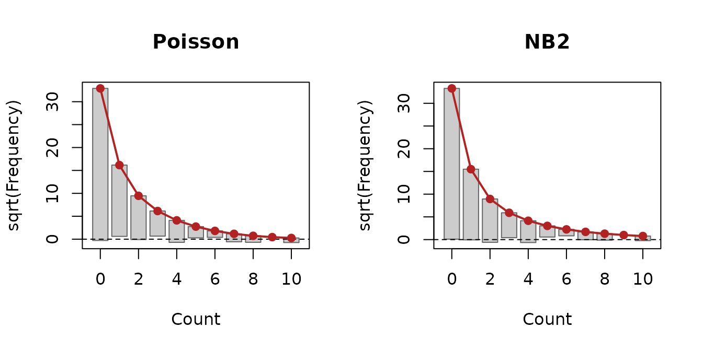
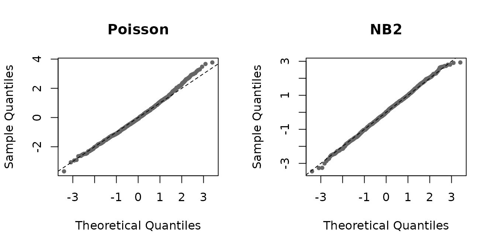
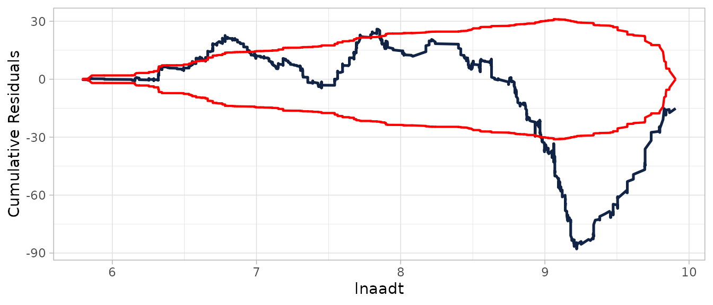

# Choosing a count distribution

flexCountReg fits the same regression model with many count
distributions. This vignette is an overview of how to choose among them:
which features of the data matter, how to fit and compare candidate
families on the same rows, which comparisons are valid, and why some
common shortcuts mislead. For a first complete analysis start with
[`vignette("getting-started", package = "flexCountReg")`](https://jwood-iastate.github.io/flexCountReg/articles/getting-started.md);
for the diagnostics used here in more depth see
[`vignette("diagnosing-count-models", package = "flexCountReg")`](https://jwood-iastate.github.io/flexCountReg/articles/diagnosing-count-models.md).

``` r

library(flexCountReg)
data("washington_roads")
```

## What to look at before choosing

A distribution is a statement about how counts vary *given the
covariates*. The useful questions are:

| Feature | Question | Families to consider |
|----|----|----|
| Conditional dispersion | Given the mean model, is the variance larger or smaller than the mean? How does it grow with the mean? | variance ∝ mean: NB1, PIG1, GP1, HERMITE; ∝ mean²: NB2, PIG2, PIG, PLN, NBGE; in between: NBP, PA |
| Underdispersion | Is the variance *smaller* than the mean? | COM, GP1/GP2, DW, DPO, HYPERPOIS, GAMMACOUNT |
| Tails | Are very large counts more frequent than a negative binomial allows? | PLN, PIG, SI, GW, PW |
| Zeros | Are there more zeros than the count distribution predicts *after* fitting it? | zero-inflated or hurdle models (`zero_formula`), PL, PLG, PGE |
| Exposure | Were the counts observed over different lengths of time or space? | any family, with an offset ([`vignette("data-exposure-weights")`](https://jwood-iastate.github.io/flexCountReg/articles/data-exposure-weights.md)) |
| Mechanism | Is there a plausible process, e.g. events in clusters or batches, or renewal with regular gaps? | Polya-Aeppli (PA, clusters), HERMITE (pairs), GAMMACOUNT (renewal) |

[`?count_families`](https://jwood-iastate.github.io/flexCountReg/reference/count_families.md)
lists every family with its parameters, variance and the features
(underreporting, likelihood-ratio tests) available for it.

## The data

The `washington_roads` data contain crashes on 507 road segments, each
observed in up to three years (1501 rows). We model total crashes as a
function of traffic volume (`lnaadt`) and the speed-limit indicator
`speed50`, with the logarithm of segment length as an offset. The models
in this overview treat every row as independent; the repeated
observations of the same segments are modelled in
[`vignette("random-parameters-and-panels", package = "flexCountReg")`](https://jwood-iastate.github.io/flexCountReg/articles/random-parameters-and-panels.md).

## Fitting candidate families on the same rows

[`countreg()`](https://jwood-iastate.github.io/flexCountReg/reference/countreg.md)
takes the distribution as `family`. Gradient-based optimizers
(`method = "BFGS"` or `"NR"`) are usually the fastest choice for the
closed-form families.

``` r

f <- Total_crashes ~ lnaadt + speed50
fit <- function(family) {
  countreg(f, data = washington_roads, family = family, offset = "lnlength",
           method = "BFGS")
}
models <- list(
  Poisson = fit("Poisson"),
  NB1 = fit("NB1"),
  NB2 = fit("NB2"),
  PIG1 = fit("PIG1"),
  GP1 = fit("GP1"),
  PA = fit("PA"),
  DELAPORTE = fit("DELAPORTE")
)
sapply(models, nobs)
#>   Poisson       NB1       NB2      PIG1       GP1        PA DELAPORTE 
#>      1501      1501      1501      1501      1501      1501      1501
```

All models use the same rows, so their log-likelihoods are comparable.
NB1 and NB2 differ in how the extra variance grows with the mean; the
Polya-Aeppli family `PA` (a Poisson-Tweedie distribution, variance
$`\mu + \phi\mu^{1.5}`$) lies between them, and the Delaporte family
mixes a Poisson and a negative binomial component.

## Comparing fit statistics

[`glance()`](https://generics.r-lib.org/reference/glance.html) gives one
row of fit statistics per model:

``` r

stats <- do.call(rbind, lapply(names(models), function(nm) {
  cbind(model = nm, glance(models[[nm]])[, c("logLik", "AIC", "BIC", "df")])
}))
stats$dAIC <- stats$AIC - min(stats$AIC)
stats[order(stats$AIC), ]
#>       model    logLik      AIC      BIC df       dAIC
#> 3       NB2 -1090.559 2189.118 2210.374  4  0.0000000
#> 6        PA -1090.750 2189.500 2210.755  4  0.3815105
#> 7 DELAPORTE -1090.152 2190.304 2216.873  5  1.1858377
#> 4      PIG1 -1096.941 2201.882 2223.138  4 12.7638096
#> 5       GP1 -1097.124 2202.247 2223.503  4 13.1288271
#> 2       NB1 -1097.226 2202.451 2223.707  4 13.3332678
#> 1   Poisson -1110.057 2226.114 2242.056  3 36.9960203
```

NB2 has the lowest AIC, but NB2, PA, DELAPORTE are within 2 AIC units of
each other, a difference too small to choose between them on this basis
alone. The families whose variance is proportional to the mean (NB1,
PIG1, GP1) are at least 12.8 AIC units behind the best model: the extra
variance grows faster than the mean in these data.

More parameters can also be weakly identified. The Delaporte model’s
share and shape parameters have large standard errors here:

``` r

summary(models$DELAPORTE)$coefficients[c("logit(rho)", "ln(k)"), 1:2]
#>               Estimate Std. Error
#> logit(rho)  0.66718570   2.421449
#> ln(k)      -0.02539755   1.861276
```

The data do not separate the Poisson and negative binomial components of
the Delaporte distribution; it offers no advantage over NB2.

## Which comparisons are valid

For a single model, [`summary()`](https://rdrr.io/r/base/summary.html)
reports a likelihood-ratio test against the Poisson model with the same
mean specification, when Poisson is a special case (on the boundary of
the parameter space for NB2, so the p-value uses a 50:50 chi-square
mixture):

``` r

summary(models$NB2)
#> Call:
#> countreg(formula = f, data = washington_roads, family = family, 
#>     offset = "lnlength", method = "BFGS")
#> 
#> Model: countreg | family: NB2 | optimizer: BFGS
#> Iterations: 37 
#> Convergence: successful convergence 
#> 
#> Coefficients (standard errors: Hessian-based):
#>             Estimate Std. Error z value Pr(>|z|)    
#> (Intercept)  -8.8959     0.4465  -19.92  < 2e-16 ***
#> lnaadt        1.1244     0.0514   21.87  < 2e-16 ***
#> speed50      -0.5678     0.1102   -5.15  2.6e-07 ***
#> ln(alpha)    -0.9125     0.2279   -4.00  6.2e-05 ***
#> ---
#> Signif. codes:  0 '***' 0.001 '**' 0.01 '*' 0.05 '.' 0.1 ' ' 1
#> Offset: lnlength (coefficient fixed at 1)
#> 
#> Log-likelihood: -1090.559 | AIC: 2189.118 | BIC: 2210.374 
#> N: 1501
#> LR test vs Poisson: chi-sq = 38.996 on 1 df, p-value = 2.12e-10 (boundary-corrected)
```

[`regCompTest()`](https://jwood-iastate.github.io/flexCountReg/reference/regCompTest.md)
compares two fitted models. Poisson is nested in NB2:

``` r

regCompTest(models$Poisson, model2 = models$NB2)$statistics
#> # A tibble: 8 × 3
#>   Statistic                 Model BaseModel
#>   <chr>                     <dbl>     <dbl>
#> 1 Log-likelihood        -1091.    -1110.   
#> 2 Number of parameters      4         3    
#> 3 AIC                    2189.     2226.   
#> 4 BIC                    2210.     2242.   
#> 5 LR Test Statistic        39.0      NA    
#> 6 LR degrees of freedom     1        NA    
#> 7 LR p-value                0        NA    
#> 8 McFadden's Pseudo R^2     0.292     0.279
```

NB1 and NB2 are not nested (neither is a special case of the other), so
no likelihood-ratio p-value is reported, only information criteria:

``` r

regCompTest(models$NB1, model2 = models$NB2)$statistics
#> Warning: The models have the same number of parameters, so they are not nested;
#> the LR test is not reported.
#> # A tibble: 8 × 3
#>   Statistic                 Model BaseModel
#>   <chr>                     <dbl>     <dbl>
#> 1 Log-likelihood        -1091.    -1097.   
#> 2 Number of parameters      4         4    
#> 3 AIC                    2189.     2202.   
#> 4 BIC                    2210.     2224.   
#> 5 LR Test Statistic        NA        NA    
#> 6 LR degrees of freedom    NA        NA    
#> 7 LR p-value               NA        NA    
#> 8 McFadden's Pseudo R^2     0.292     0.288
```

[`regCompTable()`](https://jwood-iastate.github.io/flexCountReg/reference/regCompTable.md)
builds a coefficient table across models:

``` r

regCompTable(models[c("Poisson", "NB1", "NB2")])
#> # A tibble: 9 × 4
#>   Parameter    Poisson           NB1               NB2              
#>   <chr>        <chr>             <chr>             <chr>            
#> 1 (Intercept)  -9.119 (0.424)*** -8.68 (0.471)***  -8.896 (0.446)***
#> 2 lnaadt       1.147 (0.048)***  1.097 (0.054)***  1.124 (0.051)*** 
#> 3 speed50      -0.54 (0.096)***  -0.562 (0.107)*** -0.568 (0.11)*** 
#> 4 ln(alpha)    ---               -1.308 (0.261)*** -0.913 (0.228)***
#> 5 N Obs.       1501              1501              1501             
#> 6 LL           -1110.057         -1097.226         -1090.559        
#> 7 AIC          2226.114          2202.451          2189.118         
#> 8 BIC          2242.056          2223.707          2210.374         
#> 9 Pseudo-R-Sq. 0.279             0.288             0.292
```

McFadden’s pseudo R-squared compares each model with the same baseline,
an intercept-only Poisson model, so the values are comparable across
distributions. A different baseline can be chosen with the `basemodel`
and `variables` arguments of
[`regCompTable()`](https://jwood-iastate.github.io/flexCountReg/reference/regCompTable.md)
and
[`regCompTest()`](https://jwood-iastate.github.io/flexCountReg/reference/regCompTest.md).

## Shortcuts that mislead

Three summaries are often used to choose a distribution before fitting
anything. None is sufficient on its own:

``` r

y <- washington_roads$Total_crashes
pearson <- function(m) {
  sum(residuals(m, type = "pearson")^2) / (nobs(m) - length(coef(m)))
}
expected_zeros <- sapply(models[c("Poisson", "NB2")], function(m)
  mean(predict(m, type = "prob", max_count = 0)[, 1]))
c(variance_to_mean = var(y) / mean(y),
  pearson_poisson = pearson(models$Poisson),
  observed_zeros = mean(y == 0),
  expected_zeros_poisson = expected_zeros[["Poisson"]],
  expected_zeros_nb2 = expected_zeros[["NB2"]])
#>       variance_to_mean        pearson_poisson         observed_zeros 
#>              2.1873535              1.3485030              0.7335110 
#> expected_zeros_poisson     expected_zeros_nb2 
#>              0.7212261              0.7378874
```

- **The unconditional variance-to-mean ratio** (2.19) mixes the
  variation explained by the covariates with the variation left over.
  After fitting the covariates the Poisson Pearson dispersion is 1.35:
  there is overdispersion, but less than the raw ratio suggests.
- **A large share of zeros** (73% here) is not evidence of a separate
  zero process: the fitted Poisson model already expects 72% zeros.
  Compare the observed zeros with those expected under the fitted model.
- **An AIC ranking** tells which of the fitted models is closest to the
  data among those tried. Small differences are not decisive, and a
  model that is best in-sample is not necessarily best at predicting new
  data; a held-out comparison is shown in
  [`vignette("diagnosing-count-models", package = "flexCountReg")`](https://jwood-iastate.github.io/flexCountReg/articles/diagnosing-count-models.md).

## Does the model reproduce the counts?

Information criteria rank models, but they do not show *where* a model
fails. A rootogram compares the observed frequency of each count with
the frequency expected under the fitted model, on a square-root scale.
Bars hang from the expected curve; a bar that ends above zero means the
count is over-predicted, one that ends below zero means it is
under-predicted.

``` r

oldpar <- par(mfrow = c(1, 2))
rootogram(models$Poisson, main = "Poisson")
rootogram(models$NB2, main = "NB2")
```



``` r

par(oldpar)
```

Randomized quantile residuals are approximately standard normal when the
model is correct, for any count distribution, so a normal Q-Q plot is a
useful check (the residuals are randomized, so a seed is set):

``` r

set.seed(1)
oldpar <- par(mfrow = c(1, 2))
for (nm in c("Poisson", "NB2")) {
  r <- residuals(models[[nm]], type = "quantile")
  qqnorm(r, main = nm, pch = 20, col = "grey40")
  abline(0, 1, lty = 2)
}
```



``` r

par(oldpar)
```

A CURE plot (cumulative residuals against a covariate) checks the mean
model along that covariate; its bounds assume independent residuals:

``` r

cureplot(models$NB2, indvar = "lnaadt")
```



## Modeling the dispersion and the zeros

The distribution parameters can depend on covariates. Here the NB2
dispersion depends on the speed-limit indicator:

``` r

nb2_gen <- countreg(f, data = washington_roads, family = "NB2",
                    offset = "lnlength",
                    dis_param_formula_1 = ~ speed50, method = "BFGS")
tidy(nb2_gen, conf.int = TRUE)
#> # A tibble: 5 × 8
#>   term       component estimate std.error statistic   p.value conf.low conf.high
#>   <chr>      <chr>        <dbl>     <dbl>     <dbl>     <dbl>    <dbl>     <dbl>
#> 1 (Intercep… mean        -8.89     0.449     -19.8  2.18e- 87   -9.77     -8.02 
#> 2 lnaadt     mean         1.12     0.0516     21.8  3.02e-105    1.02      1.22 
#> 3 speed50    mean        -0.552    0.120      -4.58 4.62e-  6   -0.788    -0.316
#> 4 ln(alpha)… distribu…   -1.16     0.281      -4.11 3.99e-  5   -1.71     -0.604
#> 5 ln(alpha)… distribu…    1.15     0.456       2.53 1.15e-  2    0.258     2.04
```

When there are more zeros than a count distribution allows, a
zero-inflated or hurdle version of any family can be fitted with
`zero_formula`:

``` r

zinb <- countreg(f, data = washington_roads, family = "NB2",
                 offset = "lnlength", zero_formula = ~ 1, method = "NR")
#> Warning: The Hessian is not negative definite at the estimates, so the standard
#> errors of Zero:(Intercept) are NA. The estimate may be on the boundary of the
#> parameter space or not at a maximum.
pi_zero <- unname(plogis(coef(zinb)["Zero:(Intercept)"]))
c(NB2 = as.numeric(logLik(models$NB2)), ZINB = as.numeric(logLik(zinb)),
  zero_probability = pi_zero)
#>              NB2             ZINB zero_probability 
#>    -1.090559e+03    -1.090560e+03     4.338153e-05
```

The estimated probability of a structural zero is 4.3e-05 and the
log-likelihoods differ by 5.2e-04: the zeros are already explained by
the negative binomial, so the zero-inflated model adds nothing. When an
estimate is at the boundary of its parameter space like this, its
standard error is not meaningful, and the likelihood-ratio test of NB2
against ZINB has a non-standard distribution, so it is not reported.

## Using the chosen model

Predictions have one value per row of new data. Besides the expected
count, [`predict()`](https://rdrr.io/r/stats/predict.html) gives the
probability of each count and confidence or prediction intervals:

``` r

nd <- washington_roads[1:3, ]
predict(models$NB2, newdata = nd)
#> [1] 0.7961623 0.7035853 1.1664704
round(predict(models$NB2, newdata = nd, type = "prob", max_count = 4), 3)
#>          0     1     2     3     4
#> [1,] 0.501 0.302 0.128 0.046 0.015
#> [2,] 0.538 0.295 0.113 0.037 0.011
#> [3,] 0.384 0.305 0.170 0.081 0.036
predict(models$NB2, newdata = nd, interval = "prediction", level = 0.9)
#>         fit lwr upr
#> 1 0.7961623   0   3
#> 2 0.7035853   0   3
#> 3 1.1664704   0   4
```

Marginal effects (or elasticities) on the expected count come from
[`margEffTable()`](https://jwood-iastate.github.io/flexCountReg/reference/margEffTable.md):

``` r

margEffTable(models$NB2)
#> Marginal Effects / Elasticities
#> Method: delta 
#> 
#>     term variable_type           effect_metric estimate std_error t_value
#>   lnaadt    continuous Average marginal effect    0.532     0.037  14.561
#>  speed50     indicator   Pseudo-elasticity (%)  -43.320     6.246  -6.936
#>  p_value sig lower_ci upper_ci n_obs successful_bootstraps
#>        0 ***    0.460    0.604  1501                    NA
#>        0 ***  -55.562  -31.078  1501                    NA
```

## Next steps

- [`vignette("diagnosing-count-models", package = "flexCountReg")`](https://jwood-iastate.github.io/flexCountReg/articles/diagnosing-count-models.md):
  residuals, rootograms, calibration and held-out comparisons.
- [`vignette("data-exposure-weights", package = "flexCountReg")`](https://jwood-iastate.github.io/flexCountReg/articles/data-exposure-weights.md):
  offsets, weights and analysis samples.
- [`vignette("inference-prediction-and-comparison", package = "flexCountReg")`](https://jwood-iastate.github.io/flexCountReg/articles/inference-prediction-and-comparison.md):
  standard errors and the conditions for likelihood-ratio tests.
- [`vignette("zeros-hurdles-and-sampling", package = "flexCountReg")`](https://jwood-iastate.github.io/flexCountReg/articles/zeros-hurdles-and-sampling.md):
  zero-inflated and hurdle models.
- [`vignette("distribution-parameter-regression", package = "flexCountReg")`](https://jwood-iastate.github.io/flexCountReg/articles/distribution-parameter-regression.md):
  models for the dispersion and shape parameters.
