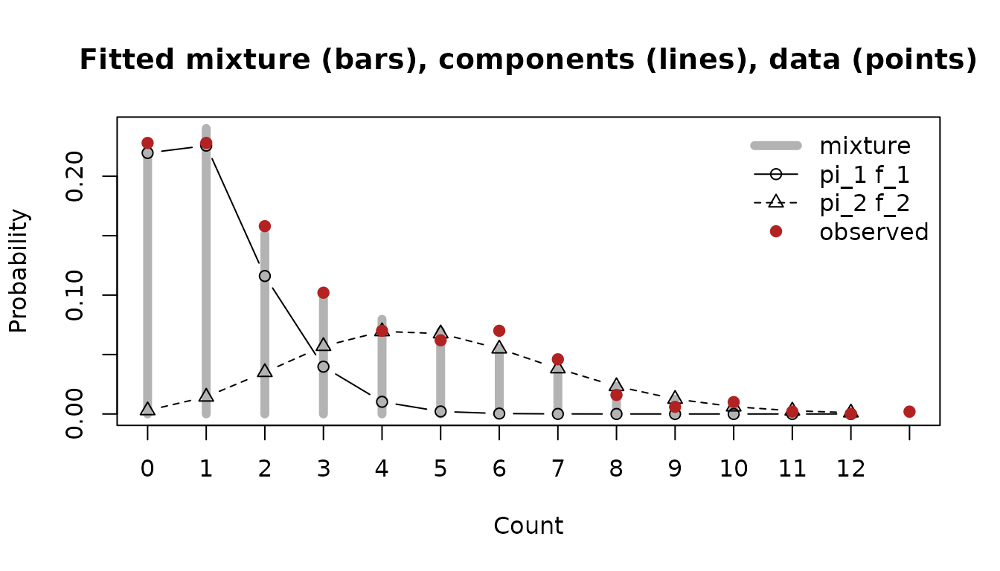
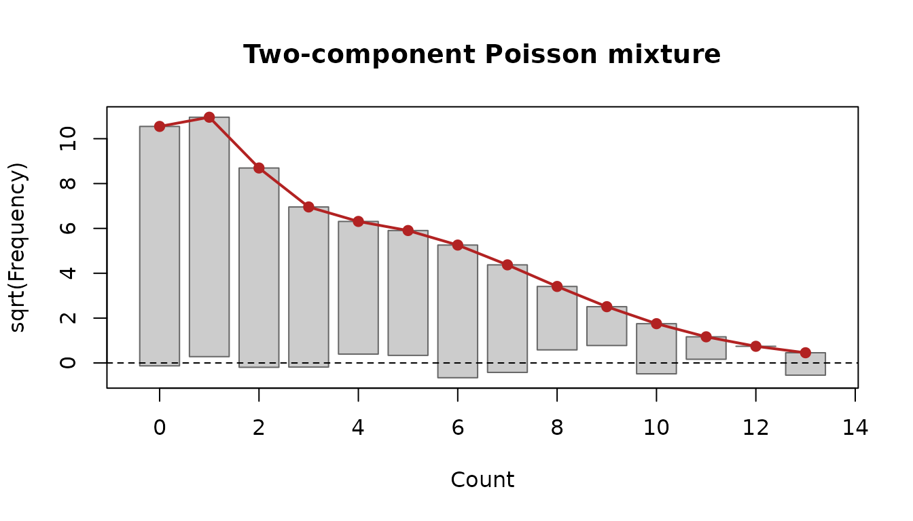

# Finite mixtures of count distributions

This article introduces finite mixtures of count distributions without
covariates: what they are, how to fit them with
[`countreg_mix()`](https://jwood-iastate.github.io/flexCountReg/reference/countreg_mix.md),
how to read the fitted object, and what a fitted mixture does and does
not tell you. The regression and latent-class version is in
[`vignette("latent-class-regression", package = "flexCountReg")`](https://jwood-iastate.github.io/flexCountReg/articles/latent-class-regression.md).

``` r

library(flexCountReg)
```

## What a finite mixture is

A finite mixture with $`K`$ components draws an unobserved component
$`C`$ with probabilities $`\pi_1, \dots, \pi_K`$ and then draws **one**
count from that component’s distribution:

``` math
P(Y = y) = \sum_{k=1}^K \pi_k f_k(y).
```

Four ideas are easily confused:

- **Finite mixture.** A probability-weighted *sum of distributions*, as
  above. It can be used purely as a flexible description of a skewed,
  multimodal or heavy-tailed count distribution.
- **Latent-class interpretation.** The same model, read as saying that
  the population consists of $`K`$ unobserved groups. That reading is an
  extra substantive assumption; the likelihood is identical, and a good
  fit with two components does not prove that two real groups exist.
- **Convolution (a sum of counts).** Adding independent counts from two
  distributions, e.g. $`Y = Y_1 + Y_2`$, gives a different distribution.
  A mixture *selects* one component; a convolution *adds* them.
- **Within-family (continuous) mixing.** Families such as PLN, PGE and
  NBGE are themselves Poisson distributions mixed over a *continuous*
  random effect (see
  [count_families](https://jwood-iastate.github.io/flexCountReg/reference/count_families.md)).
  A two-component PLN mixture has two outer components, each of which
  already contains continuous mixing. Stacking both kinds of
  heterogeneity can make the parameters weakly identified.

## Simulated data

We simulate 500 counts: 60% from a Poisson distribution with mean 1 and
40% from a Poisson distribution with mean 5, using only base R.

``` r

set.seed(2026)
n <- 500
true_class <- ifelse(runif(n) < 0.6, 1, 2)
y <- rpois(n, lambda = c(1, 5)[true_class])
d <- data.frame(y = y)
table(y)
#> y
#>   0   1   2   3   4   5   6   7   8   9  10  11  13 
#> 114 114  79  51  35  31  35  23   8   3   5   1   1
c(mean = mean(y), variance = var(y))
#>     mean variance 
#> 2.512000 6.013884
```

The generating classes are kept aside (`true_class`); they are not used
in fitting. The variance is well above the mean, as it must be for a
mixture of Poisson distributions with different means.

## Mean and variance of a mixture

For a mixture, the mean and variance are

``` math
m = \sum_k \pi_k m_k, \qquad
V = \sum_k \pi_k (V_k + m_k^2) - m^2
  = \sum_k \pi_k V_k + \sum_k \pi_k (m_k - m)^2 .
```

For the generating model ($`\pi = (0.6, 0.4)`$, means 1 and 5, Poisson
variances equal to the means) this gives:

``` r

p <- c(0.6, 0.4)
m_k <- c(1, 5)
m <- sum(p * m_k)
V <- sum(p * (m_k + m_k^2)) - m^2
c(mean = m, variance = V)
#>     mean variance 
#>     2.60     6.44
```

The variance $`6.44`$ is the within-component variance $`2.6`$ plus the
between-component variance $`3.84`$. A mixture of Poisson distributions
is therefore always at least equidispersed; mixtures of *underdispersed*
families need not be.

## Fitting a two-component Poisson mixture

[`countreg_mix()`](https://jwood-iastate.github.io/flexCountReg/reference/countreg_mix.md)
uses the formula interface of
[`countreg()`](https://jwood-iastate.github.io/flexCountReg/reference/countreg.md).
For a mixture without covariates the formula is `y ~ 1`.

``` r

fit2 <- countreg_mix(y ~ 1, data = d, family = "POISSON", components = 2,
                     n_starts = 5, seed = 42)
summary(fit2)
#> Call:
#> countreg_mix(formula = y ~ 1, data = d, family = "POISSON", components = 2, 
#>     n_starts = 5, seed = 42)
#> 
#> Finite-mixture count model with 2 components
#>   Component 1: POISSON
#>   Component 2: POISSON
#> Mixing: constant proportions (reference: Component 2)
#> Optimizer: BFGS + Newton-Raphson refinement | gradient close to zero (gradtol) 
#> 
#> Coefficients (standard errors: observed information (Hessian)):
#> 
#> Component 1 (POISSON):
#>                             Estimate Std. Error z value Pr(>|z|)
#> Component1:Mean:(Intercept)   0.0278     0.0920     0.3     0.76
#> 
#> Component 2 (POISSON):
#>                             Estimate Std. Error z value Pr(>|z|)    
#> Component2:Mean:(Intercept)   1.5833     0.0512    30.9   <2e-16 ***
#> ---
#> Signif. codes:  0 '***' 0.001 '**' 0.01 '*' 0.05 '.' 0.1 ' ' 1
#> 
#> Mixing (multinomial logit):
#>                               Estimate Std. Error z value Pr(>|z|)   
#> Mixing:Component1:(Intercept)    0.464      0.157    2.96   0.0031 **
#> ---
#> Signif. codes:  0 '***' 0.001 '**' 0.01 '*' 0.05 '.' 0.1 ' ' 1
#> 
#> Component sizes:
#>       label  family  prior posterior effective_n modal_n mean_count
#>  Component1 POISSON 0.6139    0.6139       306.9     307      1.028
#>  Component2 POISSON 0.3861    0.3861       193.1     193      4.871
#> (prior: mean membership probability; posterior: mean posterior probability;
#>  effective_n: sum of posterior probabilities; modal_n: units whose most
#>  probable component it is; mean_count: average expected count)
#> 
#> Log-likelihood: -1032.167 | AIC: 2070.334 | BIC: 2082.978 | ICL: 2344.071 
#> N: 500
#> Entropy: 130.547 | relative entropy: 0.623 
#> Starts: 5 | 5 reached the selected log-likelihood
#> Observed information: positive definite (condition number 19.9 ) | max |gradient|: 7.72e-07 
#> No likelihood-ratio test of the number of components is reported (non-standard distribution).
```

The component intercepts are on the log scale, so the estimated
component means are [`exp()`](https://rdrr.io/r/base/Log.html) of them;
the mixing coefficient is the log odds of component 1 against the
reference (the last) component. Same-family components are exchangeable,
so after fitting they are numbered in increasing order of their mean (a
display convention).

``` r

cf <- coef(fit2)
exp(cf[c("Component1:Mean:(Intercept)", "Component2:Mean:(Intercept)")])
#> Component1:Mean:(Intercept) Component2:Mean:(Intercept) 
#>                    1.028158                    4.870993
plogis(cf["Mixing:Component1:(Intercept)"])
#> Mixing:Component1:(Intercept) 
#>                     0.6138679
fit2$model$classes[, c("label", "prior_share", "effective_size",
                       "mean_count")]
#>                 label prior_share effective_size mean_count
#> Component1 Component1   0.6138679       306.9339   1.028158
#> Component2 Component2   0.3861321       193.0661   4.870993
```

The same fitted model gives the mean and variance of the mixture
directly, and they can be checked against the formulas above using the
estimates:

``` r

nd <- data.frame(y = 0)
c(mean = unname(predict(fit2, newdata = nd, type = "response")),
  variance = unname(predict(fit2, newdata = nd, type = "variance")))
#>     mean variance 
#> 2.512000 6.012373
p_hat <- fit2$model$classes$prior_share
m_hat <- predict(fit2, newdata = nd, type = "component")[1, ]
c(mean = sum(p_hat * m_hat),
  variance = sum(p_hat * (m_hat + m_hat^2)) - sum(p_hat * m_hat)^2)
#>     mean variance 
#> 2.512000 6.012373
```

### Starts

Mixture likelihoods often have several local maxima, so
[`countreg_mix()`](https://jwood-iastate.github.io/flexCountReg/reference/countreg_mix.md)
starts from several preliminary partitions of the data (reproducible
from `seed`), improves each by the EM algorithm and polishes the best
distinct solutions by maximizing the observed-data likelihood directly.
The start table records every attempt:

``` r

fit2$model$starts[, c("start", "strategy", "em_iterations", "em_status",
                      "loglik_start", "polished", "loglik", "reached_best",
                      "selected")]
#>   start strategy em_iterations em_status loglik_start polished    loglik
#> 1     1 quantile            24 converged    -1032.167    FALSE        NA
#> 2     2   jitter            23 converged    -1032.167    FALSE        NA
#> 3     3   random            26 converged    -1032.167    FALSE        NA
#> 4     4   jitter            24 converged    -1032.167     TRUE -1032.167
#> 5     5   random            28 converged    -1032.167    FALSE        NA
#>   reached_best selected
#> 1         TRUE    FALSE
#> 2         TRUE    FALSE
#> 3         TRUE    FALSE
#> 4         TRUE     TRUE
#> 5         TRUE    FALSE
```

A solution reached from several different starts is more trustworthy
than one found once. It is still not a proof that the maximum is global.

## Raw counts and a frequency table give the same fit

Without covariates, the data are fully described by the frequency of
each count. Fitting the frequency table with `weights` gives exactly the
same likelihood, because the frequency multiplies the log-likelihood of
each distinct count *outside* the logarithm of the mixture.

``` r

tab <- as.data.frame(table(y), stringsAsFactors = FALSE)
tab$y <- as.numeric(tab$y)
head(tab)
#>   y Freq
#> 1 0  114
#> 2 1  114
#> 3 2   79
#> 4 3   51
#> 5 4   35
#> 6 5   31
fit2_tab <- countreg_mix(y ~ 1, data = tab, weights = "Freq",
                         family = "POISSON", components = 2,
                         n_starts = 5, seed = 42)
c(raw = logLik(fit2), table = logLik(fit2_tab))
#>       raw     table 
#> -1032.167 -1032.167
all.equal(coef(fit2), coef(fit2_tab), tolerance = 1e-5)
#> [1] TRUE
c(raw = BIC(fit2), table = BIC(fit2_tab))
#>      raw    table 
#> 2082.978 2082.978
```

BIC also agrees, because the number of independent units is the sum of
the frequencies. This compression is valid only because nothing but the
count differs between the compressed rows. With covariates or different
exposures, rows can be combined only when all of their model inputs
agree.

## Plotting the fitted distribution

`predict(type = "prob")` returns the mixture probabilities $`P(Y = y)`$
on a finite grid; `overflow = TRUE` adds the probability of the tail
beyond the grid, so nothing is silently dropped. The weighted
contributions $`\pi_k f_k(y)`$ of the components add up to the total.
(Each $`f_k`$ alone sums to one; the weighted contributions sum to
$`\pi_k`$.)

``` r

max_count <- 12
P <- predict(fit2, newdata = nd, type = "prob", max_count = max_count,
             overflow = TRUE)
round(P, 4)
#>        0      1      2      3      4      5      6      7      8      9     10
#> 1 0.2225 0.2402 0.1512 0.0968 0.0797 0.0697 0.0553 0.0383 0.0233 0.0126 0.0061
#>       11     12   >12
#> 1 0.0027 0.0011 6e-04
grid <- 0:max_count
contrib <- sapply(1:2, function(k) p_hat[k] * dpois(grid, m_hat[k]))
all.equal(rowSums(contrib), unname(P[1, seq_along(grid)]))
#> [1] TRUE

obs <- as.vector(table(factor(pmin(y, max_count + 1),
                              levels = 0:(max_count + 1)))) / n
plot(c(grid, max_count + 1), P[1, ], type = "h", lwd = 6, col = "grey70",
     xaxt = "n", xlab = "Count", ylab = "Probability",
     ylim = c(0, max(P, obs, contrib)),
     main = "Fitted mixture (bars), components (lines), data (points)")
axis(1, at = c(grid, max_count + 1),
     labels = c(grid, paste0(">", max_count)))
lines(grid, contrib[, 1], type = "b", pch = 1, lty = 1)
lines(grid, contrib[, 2], type = "b", pch = 2, lty = 2)
points(c(grid, max_count + 1), obs, pch = 19, col = "firebrick")
legend("topright", c("mixture", "pi_1 f_1", "pi_2 f_2", "observed"),
       lty = c(1, 1, 2, NA), lwd = c(6, 1, 1, NA), pch = c(NA, 1, 2, 19),
       col = c("grey70", "black", "black", "firebrick"), bty = "n")
```



The last bar is the tail bin $`Y > 12`$. Note that the component curves
are weighted contributions; they are not the probabilities of class
membership given a count. Those posterior probabilities are a different
quantity:

``` r

post <- component_probs(fit2, conditioning = "posterior")
round(cbind(y = y, post)[order(y)[c(1, 250, 350, 450, 500)], ], 3)
#>       y Component1 Component2
#> [1,]  0      0.987      0.013
#> [2,]  2      0.768      0.232
#> [3,]  3      0.411      0.589
#> [4,]  6      0.007      0.993
#> [5,] 13      0.000      1.000
```

A rootogram compares observed and expected frequencies over all rows:

``` r

rootogram(fit2, main = "Two-component Poisson mixture")
```



## Comparing numbers of components

A one-component Poisson model, an NB2 model and the two-component
mixture are compared on the same rows with information criteria:

``` r

fit1 <- countreg_mix(y ~ 1, data = d, family = "POISSON", components = 1)
nb2 <- countreg(y ~ 1, data = d, family = "NB2", method = "BFGS")
fit3 <- countreg_mix(y ~ 1, data = d, family = "POISSON", components = 3,
                     n_starts = 5, seed = 42)
data.frame(model = c("Poisson", "NB2", "2 Poisson components",
                     "3 Poisson components"),
           logLik = sapply(list(fit1, nb2, fit2, fit3), logLik),
           df = sapply(list(fit1, nb2, fit2, fit3),
                       function(m) length(coef(m))),
           AIC = sapply(list(fit1, nb2, fit2, fit3), AIC),
           BIC = sapply(list(fit1, nb2, fit2, fit3), BIC))
#>                  model    logLik df      AIC      BIC
#> 1              Poisson -1170.078  1 2342.157 2346.371
#> 2                  NB2 -1040.967  2 2085.934 2094.363
#> 3 2 Poisson components -1032.167  3 2070.334 2082.978
#> 4 3 Poisson components -1031.950  5 2073.901 2094.974
fit3$model$classes[, c("label", "prior_share", "mean_count")]
#>                 label prior_share   mean_count
#> Component1 Component1  0.03284512 2.046596e-05
#> Component2 Component2  0.59408926 1.127026e+00
#> Component3 Component3  0.37306562 4.938665e+00
```

No likelihood-ratio p-value is given for the number of components. The
usual chi-square reference distribution does not apply when comparing
$`K`$ with $`K + 1`$ components: under the smaller model, the extra
component’s proportion is at the boundary (zero) or its parameters are
not identified, which breaks the regularity conditions of the test.
[`regCompTest()`](https://jwood-iastate.github.io/flexCountReg/reference/regCompTest.md)
refuses mixture models for this reason. Use information criteria on the
same sample, the stability of the solution across starts and,
preferably, held-out log scores (see
[`vignette("predictive-validation", package = "flexCountReg")`](https://jwood-iastate.github.io/flexCountReg/articles/predictive-validation.md)).
Also look at what an extra component does. Here the third component has
a share of about 3% and an expected count of practically zero: it is a
boundary solution (a mean parameter heading to zero) that adds a little
probability at zero, improves the log-likelihood by a fraction of a unit
and is rejected by both AIC and BIC. Such a component is a symptom of
overfitting, not a discovered group.

## Known mixing proportions

Sometimes the proportions are known from outside the data, for example
from a design (a sample deliberately drawn as 60% from one source and
40% from another) or from a census of the population being sampled. They
can then be fixed with `fixed_mixing`; they are not estimated and add no
parameters:

``` r

fit_fixed <- countreg_mix(y ~ 1, data = d, family = "POISSON",
                          components = 2, fixed_mixing = c(0.6, 0.4),
                          n_starts = 3, seed = 1)
coef(fit_fixed)
#> Component1:Mean:(Intercept) Component2:Mean:(Intercept) 
#>                 0.006919071                 1.571634562
fit_fixed$model$classes[, c("label", "prior_share", "posterior_share")]
#>                 label prior_share posterior_share
#> Component1 Component1         0.6       0.6047197
#> Component2 Component2         0.4       0.3952803
c(df_estimated = length(coef(fit2)), df_fixed = length(coef(fit_fixed)))
#> df_estimated     df_fixed 
#>            3            2
```

Known proportions are not frequency weights (which say how many
independent copies a row represents) and not starting values. They
should never be taken from a previous fit’s posterior classification of
the same data: that would use the data twice and understate uncertainty.

## Limitations

- A mixture with $`K`$ components can describe a skewed or heavy-tailed
  distribution without the components corresponding to real groups.
  Interpreting components as subpopulations needs external evidence.
- Components with similar means and small shares are weakly identified;
  their standard errors (from the observed information) may be
  unreliable. Check `fit$model$numerical`, the start table and, if
  needed, bootstrap standard errors (`stderr = "boot"`).
- Only the Poisson, NB1 and NB2 families are marked as validated mixture
  components. Other families can be used as components, but recovery of
  such mixtures has not been studied
  ([`countreg_mix()`](https://jwood-iastate.github.io/flexCountReg/reference/countreg_mix.md)
  says so with a message).

## Reproducibility

Every random step uses the `seed` argument, and the seed of every start
is stored in `fit$model$starts`, so the fits above are reproduced
exactly by re-running the code. The settings used are stored in
`fit$model$settings` and `fit$model$control`.

Next steps:

- [`vignette("latent-class-regression", package = "flexCountReg")`](https://jwood-iastate.github.io/flexCountReg/articles/latent-class-regression.md)
  for covariates, class-membership models and panels.
- [`vignette("choosing-a-count-distribution", package = "flexCountReg")`](https://jwood-iastate.github.io/flexCountReg/articles/choosing-a-count-distribution.md)
  for single-component alternatives.
- [`vignette("numerical-reliability", package = "flexCountReg")`](https://jwood-iastate.github.io/flexCountReg/articles/numerical-reliability.md)
  for reading convergence and information diagnostics.
