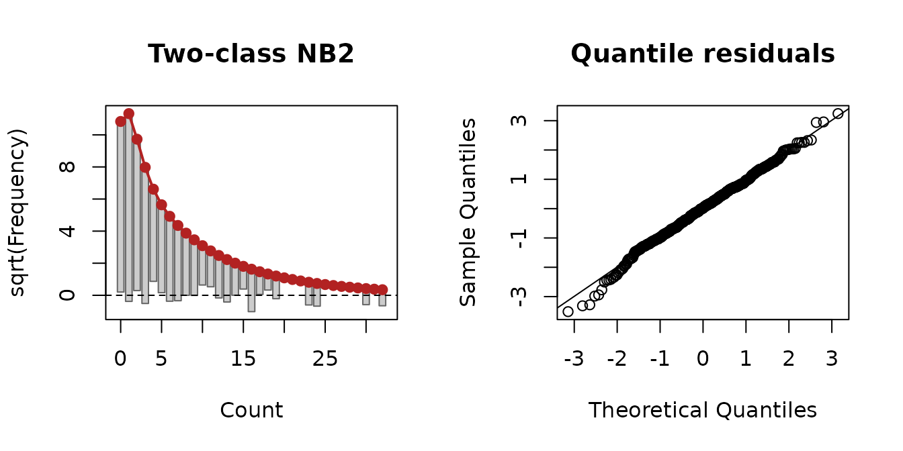
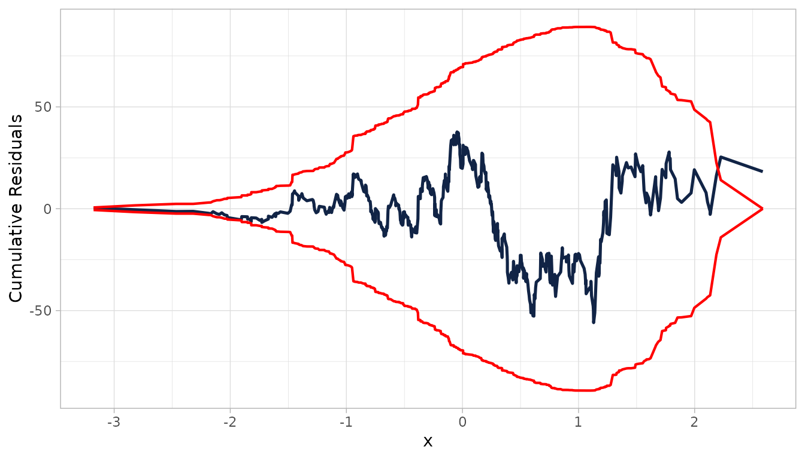

# Latent-class and finite-mixture count regression

This article fits count regressions in which the coefficients differ
between unobserved classes, and in which class membership can depend on
covariates. It covers the two equivalent interfaces, sharing parameters
between classes, choosing the number of classes, class probabilities,
predictions and marginal effects, mixtures of different families, panel
data with one class per panel, diagnostics and inference. Mixtures
without covariates are introduced in
[`vignette("finite-mixture-getting-started", package = "flexCountReg")`](https://jwood-iastate.github.io/flexCountReg/articles/finite-mixture-getting-started.md).

``` r

library(flexCountReg)
```

## The model

For unit \\i\\ with count predictors \\x_i\\ and membership predictors
\\z_i\\,

\\ P(Y_i = y) = \sum\_{k=1}^K \pi_k(z_i)\\ f_k(y \mid x_i, \theta_k),
\qquad \pi_k(z_i) = \exp(z_i^\top\gamma_k) \Big/ \sum_h
\exp(z_i^\top\gamma_h), \quad \gamma_K = 0 . \\

Each class \\k\\ has its own count regression \\f_k\\ (any family of
[`countreg()`](https://jwood-iastate.github.io/flexCountReg/reference/countreg.md)),
and the class-membership probabilities follow a multinomial logit with
the last class as reference. Count predictors and membership predictors
play different roles: \\x\\ changes the expected count *within* a class,
\\z\\ changes *which class* a unit is likely to belong to.

## Simulated data with two pathways

To keep the two pathways distinguishable, the simulated count predictor
`x` only affects the class means and the binary membership predictor `z`
only affects class membership.

``` r

set.seed(101)
n <- 600
x <- rnorm(n)
z <- rbinom(n, 1, 0.5)
true_class <- ifelse(runif(n) < plogis(-0.8 + 1.6 * z), 1, 2)
mu <- ifelse(true_class == 1, exp(0.3 + 0.2 * x), exp(1.6 + 0.6 * x))
y <- rnbinom(n, size = 1 / 0.25, mu = mu)
d <- data.frame(y, x, z)
```

Class 1 has low counts and a weak slope; class 2 has higher counts and a
steeper slope. Units with `z = 1` are more likely to be in class 1. Both
classes are NB2 with dispersion \\\alpha = 0.25\\, i.e. \\\ln\alpha =
-1.39\\.

## Two interfaces, one model

[`countreg_lc()`](https://jwood-iastate.github.io/flexCountReg/reference/countreg_mix.md)
uses latent-class vocabulary (`classes`, `membership_formula`);
[`countreg_mix()`](https://jwood-iastate.github.io/flexCountReg/reference/countreg_mix.md)
uses finite-mixture vocabulary (`components`, `mixing_formula`). Both
call the same estimation engine:

``` r

lc <- countreg_lc(y ~ x, data = d, family = "NB2", classes = 2,
                  membership_formula = ~ z, n_starts = 4, seed = 1)
mx <- countreg_mix(y ~ x, data = d, family = "NB2", components = 2,
                   mixing_formula = ~ z, n_starts = 4, seed = 1)
c(latent_class = logLik(lc), mixture = logLik(mx))
#> latent_class      mixture 
#>    -1328.679    -1328.679
all.equal(coef(lc), coef(mx))
#> [1] TRUE
class(lc)
#> [1] "countreg_lc"  "countreg_mix" "flexCountReg"
```

Coefficient names are the same in both (`Component<k>:...`); only the
printed labels differ (“Class” or “Component”).

## Sharing parameters between classes

By default every class has its own coefficients and dispersion. The
`shared` argument estimates a parameter once for all classes:
`dis1 = TRUE` shares the first distribution parameter (here the NB2
\\\ln\alpha\\), and `mean` names formula terms whose coefficients are
common.

``` r

lc_sd <- countreg_lc(y ~ x, data = d, family = "NB2", classes = 2,
                     membership_formula = ~ z,
                     shared = list(dis1 = TRUE), n_starts = 4, seed = 1)
lc_sx <- countreg_lc(y ~ x, data = d, family = "NB2", classes = 2,
                     membership_formula = ~ z,
                     shared = list(dis1 = TRUE, mean = "x"),
                     n_starts = 4, seed = 1)
data.frame(model = c("class-specific dispersion", "shared dispersion",
                     "shared dispersion and slope"),
           logLik = sapply(list(lc, lc_sd, lc_sx), logLik),
           df = sapply(list(lc, lc_sd, lc_sx), function(m) length(coef(m))),
           AIC = sapply(list(lc, lc_sd, lc_sx), AIC),
           BIC = sapply(list(lc, lc_sd, lc_sx), BIC))
#>                         model    logLik df      AIC      BIC
#> 1   class-specific dispersion -1328.679  8 2673.357 2708.533
#> 2           shared dispersion -1328.742  7 2671.484 2702.263
#> 3 shared dispersion and slope -1336.136  6 2684.273 2710.654
```

Sharing the dispersion costs almost nothing in log-likelihood (the data
were generated with a common \\\alpha\\), while forcing a common slope
is clearly worse, as it should be. A shared factor is shared as a whole
term, never as individual dummy columns. Distribution parameters can be
shared only between classes of the same family, because the “same” label
in two families (e.g. `ln(alpha)` in NB1 and NB2) does not have the same
meaning.

## Reading the summary

``` r

summary(lc_sd)
#> Call:
#> countreg_lc(formula = y ~ x, data = d, family = "NB2", classes = 2, 
#>     membership_formula = ~z, shared = list(dis1 = TRUE), n_starts = 4, 
#>     seed = 1)
#> 
#> Latent-class count model with 2 classes
#>   Class 1: NB2
#>   Class 2: NB2
#> Mixing: multinomial logit on covariates (reference: Class 2)
#> Optimizer: BFGS + Newton-Raphson refinement | gradient close to zero (gradtol) 
#> 
#> Coefficients (standard errors: observed information (Hessian)):
#> 
#> Class 1 (NB2):
#>                             Estimate Std. Error z value Pr(>|z|)  
#> Component1:Mean:(Intercept)   0.2281     0.0998    2.29    0.022 *
#> Component1:Mean:x             0.2059     0.0864    2.38    0.017 *
#> ---
#> Signif. codes:  0 '***' 0.001 '**' 0.01 '*' 0.05 '.' 0.1 ' ' 1
#> 
#> Class 2 (NB2):
#>                             Estimate Std. Error z value Pr(>|z|)    
#> Component2:Mean:(Intercept)   1.5889     0.0691    23.0   <2e-16 ***
#> Component2:Mean:x             0.5840     0.0447    13.1   <2e-16 ***
#> ---
#> Signif. codes:  0 '***' 0.001 '**' 0.01 '*' 0.05 '.' 0.1 ' ' 1
#> 
#> Shared parameters:
#>                  Estimate Std. Error z value Pr(>|z|)    
#> Shared:ln(alpha)   -1.599      0.273   -5.85  4.9e-09 ***
#> ---
#> Signif. codes:  0 '***' 0.001 '**' 0.01 '*' 0.05 '.' 0.1 ' ' 1
#> 
#> Mixing (multinomial logit):
#>                               Estimate Std. Error z value Pr(>|z|)    
#> Mixing:Component1:(Intercept)   -0.851      0.294   -2.90   0.0037 ** 
#> Mixing:Component1:z              1.657      0.289    5.73    1e-08 ***
#> ---
#> Signif. codes:  0 '***' 0.001 '**' 0.01 '*' 0.05 '.' 0.1 ' ' 1
#> 
#> Class sizes:
#>   label family  prior posterior effective_n modal_n mean_count
#>  Class1    NB2 0.5018    0.5018       301.1     319      1.269
#>  Class2    NB2 0.4982    0.4982       298.9     281      5.564
#> (prior: mean membership probability; posterior: mean posterior probability;
#>  effective_n: sum of posterior probabilities; modal_n: units whose most
#>  probable class it is; mean_count: average expected count)
#> 
#> Log-likelihood: -1328.742 | AIC: 2671.484 | BIC: 2702.263 | ICL: 3155.722 
#> N: 600
#> Entropy: 226.73 | relative entropy: 0.455 
#> Starts: 4 | 4 reached the selected log-likelihood
#> Observed information: positive definite (condition number 127 ) | max |gradient|: 8.49e-09 
#> No likelihood-ratio test of the number of classes is reported (non-standard distribution).
```

The summary groups the coefficients by class, shared parameters and the
membership model. Below it:

- **Class sizes.** `prior` is the average membership probability from
  the covariates; `posterior` the average posterior probability given
  the outcomes; `effective_n` the sum of posterior probabilities;
  `modal_n` the number of units whose most probable class it is;
  `mean_count` the class’s average expected count. Classes are numbered
  by `mean_count` (a display convention: the numbering of same-family
  classes is arbitrary).
- **Entropy.** How well the posterior probabilities separate the units.
  The relative entropy is 1 for a perfect classification and 0 when
  every unit has probabilities \\1/K\\. Low entropy does not mean a bad
  model: the mixture can describe the counts well even when individual
  units cannot be classified.
- **Starts** and **observed information** (see
  [`vignette("numerical-reliability", package = "flexCountReg")`](https://jwood-iastate.github.io/flexCountReg/articles/numerical-reliability.md)):
  how many starts reached the selected solution, whether the information
  matrix is positive definite, and the largest gradient component.

The estimates are close to the generating values (class 1: \\0.3, 0.2\\;
class 2: \\1.6, 0.6\\; \\\ln\alpha = -1.39\\; membership \\-0.8, 1.6\\),
with sampling error. The start table is in `lc_sd$model$starts`.

## How many classes?

``` r

lc_1 <- countreg_lc(y ~ x, data = d, family = "NB2", classes = 1)
lc_3 <- countreg_lc(y ~ x, data = d, family = "NB2", classes = 3,
                    membership_formula = ~ z,
                    shared = list(dis1 = TRUE), n_starts = 4, seed = 1)
fits <- list(`K = 1` = lc_1, `K = 2` = lc_sd, `K = 3` = lc_3)
data.frame(K = 1:3,
           logLik = sapply(fits, logLik),
           df = sapply(fits, function(m) length(coef(m))),
           AIC = sapply(fits, AIC), BIC = sapply(fits, BIC),
           ICL = sapply(fits, function(m) m$model$ICL),
           starts_reaching_best = sapply(fits, function(m)
             sum(m$model$starts$reached_best)))
#>       K    logLik df      AIC      BIC      ICL starts_reaching_best
#> K = 1 1 -1358.800  3 2723.600 2736.791 2736.791                    1
#> K = 2 2 -1328.742  7 2671.484 2702.263 3155.722                    4
#> K = 3 3 -1327.657 11 2677.315 2725.681 3549.552                    3
```

Here AIC and BIC both prefer two classes, the three-class fit improves
the log-likelihood by about one unit for four more parameters, and ICL
prefers one class. The disagreement is informative: the two generating
classes overlap a lot (the relative entropy in the summary above is
below 0.5), so the mixture describes the counts better than one NB2
regression, but individual units cannot be assigned to a class with
confidence, and ICL penalizes exactly that. Some caveats apply to any
such table:

- No likelihood-ratio test of \\K\\ against \\K + 1\\ is reported, and
  [`regCompTest()`](https://jwood-iastate.github.io/flexCountReg/reference/regCompTest.md)
  refuses mixture models: the chi-square reference distribution does not
  hold when a class can vanish or two classes merge.
- ICL (\\\text{BIC} + 2 \times \text{entropy}\\) favors well-separated
  classes. It answers a classification question, not “which model
  predicts best”; with \\K = 1\\ it equals BIC.
- Information criteria are comparable only on the same rows and outcome.
  Held-out log scores (see
  [`vignette("predictive-validation", package = "flexCountReg")`](https://jwood-iastate.github.io/flexCountReg/articles/predictive-validation.md))
  are the more direct check of predictive value.
- Choosing \\K\\ from the data and then reporting Wald intervals for the
  chosen model ignores the selection step.

## Class probabilities: prior and posterior

[`class_probs()`](https://jwood-iastate.github.io/flexCountReg/reference/component_probs.md)
(or
[`component_probs()`](https://jwood-iastate.github.io/flexCountReg/reference/component_probs.md))
returns membership probabilities. The *prior* probabilities depend only
on `z`; the *posterior* probabilities also use each unit’s own outcome.

``` r

prior <- class_probs(lc_sd, conditioning = "prior")
post <- class_probs(lc_sd, conditioning = "posterior")
colnames(prior) <- paste0("prior_", colnames(prior))
colnames(post) <- paste0("posterior_", colnames(post))
head(cbind(d[, c("y", "x", "z")], round(prior, 3), round(post, 3)))
#>   y          x z prior_Class1 prior_Class2 posterior_Class1 posterior_Class2
#> 1 5 -0.3260365 0        0.299        0.701            0.039            0.961
#> 2 4  0.5524619 1        0.691        0.309            0.499            0.501
#> 3 1 -0.6749438 0        0.299        0.701            0.474            0.526
#> 4 1  0.2143595 1        0.691        0.309            0.920            0.080
#> 5 2  0.3107692 0        0.299        0.701            0.491            0.509
#> 6 2  1.1739663 0        0.299        0.701            0.759            0.241
aggregate(cbind(prior_class1 = prior[, 1]) ~ z, data = d, FUN = mean)
#>   z prior_class1
#> 1 0    0.2992070
#> 2 1    0.6913218
table(estimated = max.col(post), generating = true_class)
#>          generating
#> estimated   1   2
#>         1 257  62
#>         2  45 236
```

The cross-tabulation is possible only because the data were simulated.
The modal (most probable) class is a descriptive, uncertain
classification; it should not be treated as an observed variable in
further analyses without accounting for that uncertainty.

## Predictions

The expected count of the mixture is the probability-weighted average of
the class expected counts.
[`predict()`](https://rdrr.io/r/stats/predict.html) returns either:

``` r

nd <- data.frame(x = c(-1, 0, 1, 0), z = c(0, 0, 0, 1), y = NA)
cbind(nd[, c("x", "z")],
      predict(lc_sd, newdata = nd, type = "component"),
      prior_class1 = class_probs(lc_sd, newdata = nd)[, 1],
      mixture = predict(lc_sd, newdata = nd, type = "response"))
#>    x z   Class1   Class2 prior_class1  mixture
#> 1 -1 0 1.022482 2.731452    0.2992070 2.220116
#> 2  0 0 1.256271 4.898229    0.2992070 3.808530
#> 3  1 0 1.543515 8.783843    0.2992070 6.617486
#> 4  0 1 1.256271 4.898229    0.6913218 2.380464
```

The default `conditioning = "prior"` uses only covariates, so these are
predictions for new units; changing the outcome column of `newdata`
cannot change them. `conditioning = "posterior"` gives the retrospective
version, conditioned on the outcomes of units whose counts are known,
which is not an out-of-sample prediction. There is no single linear
predictor of the mixture; `type = "link"` returns one per class.

## Marginal effects: two pathways

A predictor can change the mixture mean through the class means and
through the class probabilities:

\\ \partial m_i / \partial v = \sum_k \pi\_{i,k} \\ \partial m\_{i,k} /
\partial v + \sum_k m\_{i,k} \\ \partial \pi\_{i,k} / \partial v . \\

[`margEffTable()`](https://jwood-iastate.github.io/flexCountReg/reference/margEffTable.md)
differentiates the full prediction, so both terms are included, and
variables that enter only the membership model (here `z`) are listed:

``` r

margEffTable(lc_sd)
#> Marginal Effects / Elasticities
#> Method: delta 
#> 
#>  term variable_type           effect_metric estimate std_error t_value p_value
#>     x    continuous Average marginal effect    1.784     0.186   9.591       0
#>     z     indicator   Pseudo-elasticity (%)  -36.340     4.698  -7.735       0
#>  sig lower_ci upper_ci n_obs successful_bootstraps
#>  ***    1.420    2.149   600                    NA
#>  ***  -45.548  -27.132   600                    NA
```

The effect of `x` works only through the class means; the effect of `z`
works only through membership (moving units towards the low-count class
lowers the expected count). Standard errors use the delta method with
the full covariance matrix of the fit; bootstrap standard errors of
marginal effects are not yet available for mixtures. An overall effect
is *not* the average of the class-specific slopes.

## Mixtures of different families

Classes need not share a family. Here a Poisson class and an NB2 class
are estimated jointly; the names of the `family` vector become class
labels:

``` r

mf <- countreg_mix(y ~ x, data = d, family = c(low = "POISSON", high = "NB2"),
                   mixing_formula = ~ z, n_starts = 4, seed = 1)
coef(mf)
#>   Component1:Mean:(Intercept)             Component1:Mean:x 
#>                     0.1022334                     0.1592997 
#>   Component2:Mean:(Intercept)             Component2:Mean:x 
#>                     1.5432941                     0.5800074 
#>          Component2:ln(alpha) Mixing:Component1:(Intercept) 
#>                    -1.4576594                    -1.0665341 
#>           Mixing:Component1:z 
#>                     1.6096611
mf$model$classes[, c("label", "family", "prior_share", "mean_count")]
#>      label  family prior_share mean_count
#> low    low POISSON   0.4505758   1.112655
#> high  high     NB2   0.5494242   5.305852
c(AIC_mixed = AIC(mf), AIC_NB2_NB2 = AIC(lc_sd))
#>   AIC_mixed AIC_NB2_NB2 
#>    2672.140    2671.484
```

Components of different families keep the order given in `family` (they
are not exchangeable). Only Poisson, NB1 and NB2 are validated as
mixture components; other families can be used, with a message that such
mixtures are experimental.

## Panel data: one class per panel

With `group_var`, every row of a panel belongs to the same unknown
class, so the panel likelihood is a mixture of products, \\\sum_k \pi_k
\prod\_{t} f_k(y\_{t})\\, not a product of mixtures. The panel is the
independent unit (BIC uses the number of panels), and membership
variables must be constant within each panel.

``` r

set.seed(202)
G <- 120; Tt <- 6
pd <- data.frame(id = rep(seq_len(G), each = Tt), t = rep(seq_len(Tt), G))
w_panel <- rbinom(G, 1, 0.5)
cls_panel <- ifelse(runif(G) < plogis(-0.5 + 1.5 * w_panel), 1, 2)
pd$w <- w_panel[pd$id]
pd$x <- rnorm(nrow(pd))
pd$y <- rpois(nrow(pd), exp(c(0, 1.2)[cls_panel[pd$id]] + 0.4 * pd$x))
pfit <- countreg_lc(y ~ x, data = pd, classes = 2, membership_formula = ~ w,
                    group_var = "id", shared = list(mean = "x"),
                    n_starts = 4, seed = 1)
coef(pfit)
#>   Component1:Mean:(Intercept)   Component2:Mean:(Intercept) 
#>                   -0.07607009                    1.20517587 
#>                 Shared:Mean:x Mixing:Component1:(Intercept) 
#>                    0.44335992                   -0.51983540 
#>           Mixing:Component1:w 
#>                    1.76699865
c(rows = nobs(pfit), panels = attr(logLik(pfit), "nobs"))
#>   rows panels 
#>    720    120
```

### New panels versus panels with a history

For a new panel, only the membership covariates are known, so
predictions use the prior class probabilities. For a panel with earlier
observations, the class probabilities can be updated once with the
likelihood of that history, and then used to predict later rows. Here
periods 1 to 4 are the history and periods 5 and 6 the target:

``` r

history <- subset(pd, t <= 4)
target <- subset(pd, t >= 5)
head(history[, c("id", "t", "w", "x", "y")], 4)
#>   id t w          x y
#> 1  1 1 0  0.2248802 4
#> 2  1 2 0  0.7585108 9
#> 3  1 3 0 -0.8405271 2
#> 4  1 4 0 -1.3290907 1
head(target[, c("id", "t", "w", "x", "y")], 4)
#>    id t w          x y
#> 5   1 5 0 -0.5502363 1
#> 6   1 6 0  0.8314930 4
#> 11  2 5 1 -1.2319494 0
#> 12  2 6 1 -0.5315831 1

pred_new <- predict(pfit, newdata = target)                      # prior
pred_hist <- predict(pfit, newdata = target, conditioning = "history",
                     history = history)
head(cbind(target[, c("id", "t", "y")], new_panel = pred_new,
           with_history = pred_hist))
#>    id t y new_panel with_history
#> 5   1 5 1 1.9105917    2.6148812
#> 6   1 6 4 3.5254792    4.8250545
#> 11  2 5 0 0.8483221    0.5367369
#> 12  2 6 1 1.1572187    0.7321770
#> 17  3 5 2 2.7476668    3.7438778
#> 18  3 6 3 2.2517470    3.0681543
c(MAE_new_panel = mean(abs(target$y - pred_new)),
  MAE_with_history = mean(abs(target$y - pred_hist)))
#>    MAE_new_panel MAE_with_history 
#>         1.356235         1.084002
```

Only the history outcomes are used. Changing the target outcomes does
not change the history-conditioned predictions:

``` r

target_changed <- target
target_changed$y <- 999
all.equal(pred_hist,
          predict(pfit, newdata = target_changed, conditioning = "history",
                  history = history))
#> [1] TRUE
```

Panels without history rows use their prior probabilities. The model
assumes rows are independent given the class; it does not let a panel
change class over time.

## Random parameters within classes

Classes describe discrete groups of units. Units can also differ
continuously within a class: the effect of `x` can vary from panel to
panel around its class mean. `rpar_formula` adds random parameters
within the classes (a latent-class random-parameters model):

\\ L_g = \sum_k \pi_k \int \prod_t f_k(y_t \mid x_t, \beta_k + b)\\
dF_k(b). \\

Each class’s coefficient of a random variable is the mean of its random
parameter, and each class has its own standard deviation (`SD:`), unless
`shared = list(rpar = TRUE)` gives all classes the same one. Here the
slope of `x` varies within each class:

``` r

set.seed(31)
G <- 200; Tt <- 5
rd <- data.frame(id = rep(seq_len(G), each = Tt))
cls <- ifelse(runif(G) < 0.6, 1, 2)[rd$id]
rd$x <- rnorm(nrow(rd))
slope <- c(0.5, -0.3)[cls] + rnorm(G)[rd$id] * c(0.5, 0.3)[cls]
rd$y <- rpois(nrow(rd), exp(c(0.2, 1.5)[cls] + slope * rd$x))
lcrp <- countreg_lc(y ~ x, data = rd, classes = 2, group_var = "id",
                    rpar_formula = ~ x, rpar_draws = 80, n_starts = 3,
                    seed = 1)
lcfix <- countreg_lc(y ~ x, data = rd, classes = 2, group_var = "id",
                     n_starts = 3, seed = 1)
round(coef(lcrp), 3)
#>   Component1:Mean:(Intercept)             Component1:Mean:x 
#>                         0.176                         0.499 
#>               Component1:SD:x   Component2:Mean:(Intercept) 
#>                         0.491                         1.509 
#>             Component2:Mean:x               Component2:SD:x 
#>                        -0.310                         0.251 
#> Mixing:Component1:(Intercept) 
#>                         0.446
AIC(lcfix, lcrp)
#>       df      AIC
#> lcfix  5 4051.569
#> lcrp   7 3854.371
```

The classes are found (true intercepts 0.2 and 1.5, mean slopes 0.5 and
-0.3), and so are the standard deviations of the slope within them (0.5
and 0.3). Without random parameters, the variation of the slopes within
each class is left in the counts, and the fit is much worse.

The likelihood is simulated with `rpar_draws` draws per panel (the same
draws for every class), with analytic gradients. Predictions,
probabilities, class probabilities and residuals integrate over the
random parameters, and
[`simulate()`](https://rdrr.io/r/stats/simulate.html) draws new
coefficients for every panel. `rpardists` and `correlated` work as in
[`countreg_rp()`](https://jwood-iastate.github.io/flexCountReg/reference/countreg_rp.md).

Classes and random parameters can stand in for each other: a class can
take the place of a tail of a random parameter, and a large standard
deviation the place of a missing class. Shared standard deviations are
the more stable choice, and the start table shows whether several starts
reach the same solution.

## Diagnostics

Diagnostics use the prior mixture (covariates only), so they do not use
each unit’s outcome to classify it before checking it.

``` r

oldpar <- par(mfrow = c(1, 2))
rootogram(lc_sd, main = "Two-class NB2")
qr <- residuals(lc_sd, type = "quantile")
qqnorm(qr, main = "Quantile residuals"); qqline(qr)
```



``` r

par(oldpar)
```

Randomized quantile residuals use the mixture’s own distribution
function; they are approximately standard normal when the model is
correct. A CURE plot shows cumulative residuals along a covariate:

``` r

cureplot(lc_sd, indvar = "x")
```



The reference limits drawn by
[`cureplot()`](https://jwood-iastate.github.io/flexCountReg/reference/cureplot.md)
are those of the cureplots package, computed from the residuals; treat
them as a descriptive guide, not as a validated band for mixture models.
For distribution-only mixtures (`y ~ 1`) every fitted value is the same,
so a CURE plot against the fitted values carries no information; use
rootograms there.

## A real-data example

The bundled `abalone_rings` data hold shell-ring counts of 4,177 abalone
(see
[`?abalone_rings`](https://jwood-iastate.github.io/flexCountReg/reference/abalone_rings.md)).
To keep this article fast, we use a random subset of 1,000 animals and a
Poisson regression of the rings on the logarithm of the shell weight.

``` r

data("abalone_rings")
set.seed(3)
ab <- abalone_rings[sample(nrow(abalone_rings), 1000), ]
ab$log_shell <- log(ab$shell_weight)
ab_1 <- countreg(rings ~ log_shell, data = ab, family = "POISSON",
                 method = "BFGS")
ab_2 <- countreg_lc(rings ~ log_shell, data = ab, family = "POISSON",
                    classes = 2, n_starts = 4, seed = 1)
#> Warning: The Hessian is not negative definite at the estimates, so the standard
#> errors of Mixing:Component1:(Intercept) are NA. The estimate may be on the
#> boundary of the parameter space or not at a maximum.
#> Warning: Components 1-2 are nearly identical (same family and almost the same
#> parameters): the fit is effectively one component fewer, and their shares and
#> means are arbitrary. Use fewer components.
coef(ab_2)
#>   Component1:Mean:(Intercept)     Component1:Mean:log_shell 
#>                     2.7337711                     0.2773758 
#>   Component2:Mean:(Intercept)     Component2:Mean:log_shell 
#>                     2.7339358                     0.2774573 
#> Mixing:Component1:(Intercept) 
#>                     0.5789948
ab_2$model$classes[, c("label", "prior_share", "mean_count")]
#>         label prior_share mean_count
#> Class1 Class1   0.6408361   9.942788
#> Class2 Class2   0.3591639   9.943208
ab_2$model$numerical$information
#> [1] "singular"
data.frame(model = c("Poisson", "2-class Poisson"),
           logLik = c(logLik(ab_1), logLik(ab_2)),
           AIC = c(AIC(ab_1), AIC(ab_2)), BIC = c(BIC(ab_1), BIC(ab_2)))
#>             model   logLik     AIC      BIC
#> 1         Poisson -2309.09 4622.18 4631.996
#> 2 2-class Poisson -2309.09 4628.18 4652.719
```

Every start reached the same solution, and it is degenerate: the two
classes have practically the same coefficients, the log-likelihood
equals that of the one-class Poisson regression, and the observed
information is singular because the mixing proportion has no effect on
the likelihood when the classes coincide (hence the warning about its
standard error). This is the expected outcome here. A mixture of Poisson
distributions is always at least as dispersed as a Poisson distribution,
while ring counts are underdispersed given shell size (see
[`?abalone_rings`](https://jwood-iastate.github.io/flexCountReg/reference/abalone_rings.md)),
so adding Poisson classes cannot help. The right reading is “no evidence
of classes in this model”, not “two groups with about 65% and 35% of the
animals”: the reported shares are arbitrary when the classes coincide.
For underdispersed counts, use single-component families that allow it
([`vignette("choosing-a-count-distribution", package = "flexCountReg")`](https://jwood-iastate.github.io/flexCountReg/articles/choosing-a-count-distribution.md)).
When a mixture does improve the fit of real data, interpret its classes
just as cautiously: before reading them as biological groups (for
example infants versus adults), compare them with models that use the
observed `sex` directly.

## Inference

Standard errors come by default from the observed information of the
full parameter vector (all classes, shared parameters and the membership
model jointly), not from the separate EM steps. Alternatives:

``` r

# Sandwich standard errors from unit-level (row or panel) scores
fit_rob <- update(lc_sd, stderr = "robust")
# Nonparametric bootstrap of units: each replicate refits the whole mixture
# from the original estimates plus `boot_starts` new starts, and its classes
# are aligned with the original ones before computing the covariance
fit_boot <- update(lc_sd, stderr = "boot", bootstraps = 200,
                   control = lc_control(boot_starts = 3))
fit_boot$model$n_boot_ok        # replicates used
fit_boot$model$n_boot_ambiguous # replicates with ambiguous class matching
```

Near a boundary (a nearly empty class, two nearly identical classes, or
membership coefficients diverging because a covariate separates the
classes) the information matrix is singular or ill-conditioned and Wald
intervals are unreliable;
[`summary()`](https://rdrr.io/r/base/summary.html) reports this under
“Observed information”. Overall predictions do not depend on class
labels and are often well determined even when class-specific
coefficients are not.

## Not yet available

- Zero-inflated, hurdle and underreporting components within mixtures.
- Different formulas for different components (all components share the
  mean and distribution-parameter formulas, with component-specific
  coefficients unless shared).
- Confidence, prediction and tolerance intervals for mixture predictions
  (`predict(interval = ...)` and
  [`tolerance_interval()`](https://jwood-iastate.github.io/flexCountReg/reference/tolerance_interval.md)
  refuse mixtures).
- Bootstrap standard errors of marginal effects (`se = "delta"` works).
- A calibrated test of the number of classes.
- Classes that change over time within a panel (hidden Markov models).
- Smooth terms together with random parameters, and heterogeneity in the
  means or variances of the random parameters (`het_mean_formula`,
  `het_var_formula` of
  [`countreg_rp()`](https://jwood-iastate.github.io/flexCountReg/reference/countreg_rp.md)).

## Reproducibility

All starts are generated from `seed` and recorded in `fit$model$starts`;
the caller’s random-number stream is not changed. The settings, the
control object and the trained model blueprint are stored in the fitted
object (`fit$model$settings`, `fit$model$control`,
`fit$model$blueprint`).

Related articles:

- [`vignette("finite-mixture-getting-started", package = "flexCountReg")`](https://jwood-iastate.github.io/flexCountReg/articles/finite-mixture-getting-started.md)
- [`vignette("random-parameters-and-panels", package = "flexCountReg")`](https://jwood-iastate.github.io/flexCountReg/articles/random-parameters-and-panels.md)
  for continuous heterogeneity
- [`vignette("prediction-for-panel-data", package = "flexCountReg")`](https://jwood-iastate.github.io/flexCountReg/articles/prediction-for-panel-data.md)
- [`vignette("diagnosing-count-models", package = "flexCountReg")`](https://jwood-iastate.github.io/flexCountReg/articles/diagnosing-count-models.md)
- [`vignette("predictions-and-effects", package = "flexCountReg")`](https://jwood-iastate.github.io/flexCountReg/articles/predictions-and-effects.md)

## References

Grün, B., & Leisch, F. (2008). FlexMix version 2: Finite mixtures with
concomitant variables and varying and constant parameters. *Journal of
Statistical Software*, 28(4), 1-35.

McLachlan, G. J., & Peel, D. (2000). *Finite Mixture Models*. Wiley.

Wedel, M., DeSarbo, W. S., Bult, J. R., & Ramaswamy, V. (1993). A latent
class Poisson regression model for heterogeneous count data. *Journal of
Applied Econometrics*, 8(4), 397-411.
