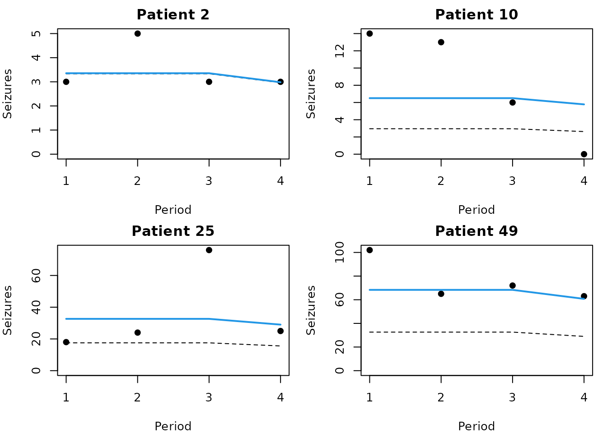

# Predicting new units and known units in panel data

With repeated measurements of the same units, “the prediction” can mean
several things: the expected count for a new unit, a summary for a unit
whose outcomes have been seen, or a forecast of a known unit’s next
observation. They condition on different information and must be
evaluated differently. This vignette fits a random-intercept model to a
clinical trial and shows which of these targets flexCountReg supports.

``` r

library(flexCountReg)
```

## Data: seizure counts

[`MASS::epil`](https://rdrr.io/pkg/MASS/man/epil.html) records the
number of epileptic seizures of 59 patients in a trial of the drug
progabide (Thall and Vail, 1990), in the corrected version of the MASS
package ([`?MASS::epil`](https://rdrr.io/pkg/MASS/man/epil.html)
describes the correction). Each patient has four rows, one per two-week
follow-up period; the count in the eight-week baseline period before
treatment is a covariate (`base`, and `lbase`, the log of a quarter of
it, centred), not a response, so it is not duplicated as an observation.

``` r

epil <- MASS::epil
table(table(epil$subject))     # rows per patient
#> 
#>  4 
#> 59
# the periods are 1 to 4 in order for every patient
all(tapply(epil$period, epil$subject, function(p) identical(p, 1:4)))
#> [1] TRUE
epil$progabide <- as.numeric(epil$trt == "progabide")
```

## The model

Each patient $`i`$ has a random intercept
$`b_i \sim N(\mu_b, \sigma_b^2)`$ shared by their four periods $`t`$,
and given $`b_i`$ the counts are NB2 with mean

``` math
\mu_{it} = \exp(b_i + \beta_1\,\text{progabide}_i +
\beta_2\,\text{lbase}_i + \beta_3\,\text{lage}_i + \beta_4\,\text{V4}_t).
```

The intercept is in `rpar_formula` and removed from `formula`, so the
treatment enters as a 0/1 variable rather than a factor with both
levels. `group_var = "subject"` makes the four rows of a patient share
one draw:

``` r

fe <- y ~ -1 + progabide + lbase + lage + V4
rp <- countreg_rp(fe, rpar_formula = ~ 1, data = epil, family = "NB2",
                  group_var = "subject", ndraws = 200, method = "BFGS")
rp$model$converged
#> [1] TRUE
round(summary(rp)$coefficients[, 1:2], 3)
#>                    Estimate Std. Error
#> progabide            -0.315      0.150
#> lbase                 1.028      0.101
#> lage                  0.328      0.351
#> V4                   -0.118      0.087
#> (Intercept):Mean      1.850      0.109
#> (Intercept):St.Dev    0.491      0.061
#> ln(alpha)            -2.008      0.238
```

The coefficients are effects on the log of the expected count *given*
the patient’s intercept. The standard deviation of the intercept
(`(Intercept):St.Dev`) measures how much patients with the same
covariates differ in their seizure rates.

## Prediction targets

| Target | Conditions on | flexCountReg |
|----|----|----|
| Expected count of a new patient | covariates only | `predict(method = "Exact")` or `"Simulated"` |
| Summary of a patient whose counts were observed | covariates and that patient’s observed counts | `predict(method = "Individual")` (Empirical Bayes) |
| Forecast of a known patient’s later period | covariates and that patient’s *earlier* counts only | not available for random-parameter models (see below) |

For one patient:

``` r

p1 <- epil[epil$subject == 1, ]
data.frame(period = p1$period, y = p1$y,
           new_patient = predict(rp, newdata = p1, method = "Exact"),
           simulated = predict(rp, newdata = p1, method = "Simulated"),
           empirical_bayes = predict(rp, newdata = p1, method = "Individual"))
#>   period y new_patient simulated empirical_bayes
#> 1      1 5    3.420274  3.389338        3.380582
#> 2      2 3    3.420274  3.389338        3.380582
#> 3      3 3    3.420274  3.389338        3.380582
#> 4      4 3    3.038680  3.011195        3.003416
```

`Exact` integrates over the random intercept with its moment-generating
function; `Simulated` averages over the Halton draws and differs from it
by the simulation error. Both describe a *new* patient with these
covariates. `Individual` weights each draw of the intercept by the
likelihood of the patient’s four observed counts; it describes this
patient, and it uses their outcomes.

A patient identifier that was not in the training data does not matter
for the population prediction, which uses the covariates only:

``` r

p_new <- p1
p_new$subject <- 999
all.equal(predict(rp, newdata = p_new, method = "Exact"),
          predict(rp, newdata = p1, method = "Exact"))
#> [1] TRUE
```

### Profiles

Observed counts of four patients with the population prediction (dashed)
and the Empirical Bayes prediction (solid):

``` r

show <- c(2, 10, 25, 49)
op <- par(mfrow = c(2, 2), mar = c(4, 4, 2, 1))
for (s in show) {
  d <- epil[epil$subject == s, ]
  pop <- predict(rp, newdata = d, method = "Exact")
  eb <- predict(rp, newdata = d, method = "Individual")
  plot(d$period, d$y, pch = 19, ylim = range(0, d$y, pop, eb),
       xlab = "Period", ylab = "Seizures", main = paste("Patient", s),
       xaxt = "n")
  axis(1, at = 1:4)
  lines(d$period, pop, lty = 2)
  lines(d$period, eb, lwd = 2, col = 4)
}
```



``` r

par(op)
```

The Empirical Bayes predictions move from the population prediction
toward each patient’s own counts: they condition on the counts plotted
in the same panel.

## New patients: hold out whole patients

To estimate how well the model predicts a *new* patient, all four rows
of a patient must be held out together and the prediction must not use
their counts. Five folds of patients, with a pooled NB2 model as the
comparison:

``` r

ids <- unique(epil$subject)
set.seed(7)
fold_of <- setNames(sample(rep(1:5, length.out = length(ids))), ids)
epil$fold <- fold_of[as.character(epil$subject)]
held_out <- do.call(rbind, lapply(1:5, function(k) {
  train <- epil[epil$fold != k, ]
  test <- epil[epil$fold == k, ]
  m_rp <- countreg_rp(fe, rpar_formula = ~ 1, data = train, family = "NB2",
                      group_var = "subject", ndraws = 200, method = "BFGS")
  m_pool <- countreg(y ~ progabide + lbase + lage + V4, data = train,
                     family = "NB2", method = "BFGS")
  data.frame(fold = k, subject = test$subject, y = test$y,
             random_intercept = predict(m_rp, newdata = test,
                                        method = "Exact"),
             pooled = predict(m_pool, newdata = test),
             converged = m_rp$model$converged)
}))
all(held_out$converged)
#> [1] TRUE
sapply(held_out[c("random_intercept", "pooled")], function(p)
  c(MAE = mean(abs(held_out$y - p)), RMSE = sqrt(mean((held_out$y - p)^2))))
#>      random_intercept   pooled
#> MAE          4.697688 4.693061
#> RMSE         9.259691 9.193978
```

For a new patient, the random-intercept model has no information beyond
the covariates, and its mean predictions are close to those of the
pooled model. Its advantages lie elsewhere: valid standard errors for
the covariate effects, and the ability to describe or (with history)
forecast individual patients.

### Empirical Bayes is not a held-out prediction

``` r

c(empirical_bayes_in_sample = mean(abs(epil$y - predict(rp, newdata = epil,
                                                         method = "Individual"))),
  population_in_sample = mean(abs(epil$y - predict(rp, newdata = epil,
                                                    method = "Exact"))))
#> empirical_bayes_in_sample      population_in_sample 
#>                  2.634991                  4.345251
```

The Empirical Bayes error is much smaller because each prediction used
the count it is compared with. It is a description of the observed
patients, not an estimate of predictive accuracy.

## Forecasting a known patient’s later period

A forecast of period 4 for a patient seen in periods 1 to 3 should
condition on those three counts only. The model should be fitted without
the period-4 counts of the patients being forecast, and the conditioning
must integrate over the patient’s intercept given their history.

For random-parameter models, flexCountReg does not yet provide this
forecast. `method = "Individual"` uses the observed counts of all the
rows it is given; a row whose count is missing gets `NA` rather than a
forecast:

``` r

p1_hist <- p1
p1_hist$y[4] <- NA
predict(rp, newdata = p1_hist, method = "Individual")
#> [1] 3.385678 3.385678 3.385678       NA
#> attr(,"eb_coefficients")
#>      (Intercept)
#> [1,]    1.959762
#> [2,]    1.959762
#> [3,]    1.959762
#> [4,]          NA
#> attr(,"eb_sd")
#>      (Intercept)
#> [1,]   0.2990761
#> [2,]   0.2990761
#> [3,]   0.2990761
#> [4,]          NA
```

Computing the Empirical Bayes prediction with the period-4 count
included and calling it a forecast would leak the answer into the
prediction.

## Totals over a patient’s periods

The expected total over the four periods of a new patient is the sum of
the four expected counts. A *distribution* for the total, for example
the probability of more than 40 seizures in eight weeks, needs joint
simulation: the four periods share one intercept, so they are positively
correlated, and simulating them independently understates the spread.

``` r

co <- coef(rp)
patient <- epil[epil$subject == 1, ]
x_fixed <- as.vector(model.matrix(~ -1 + progabide + lbase + lage + V4,
                                  patient) %*%
                       co[c("progabide", "lbase", "lage", "V4")])
size <- 1 / exp(co[["ln(alpha)"]])           # NB2: Var = mu + alpha mu^2
mu_b <- co[["(Intercept):Mean"]]
sd_b <- abs(co[["(Intercept):St.Dev"]])
set.seed(42)
R <- 20000
# joint: one intercept per simulated patient, shared by the four periods
b <- rnorm(R, mu_b, sd_b)
joint <- rowSums(sapply(1:4, function(t)
  rnbinom(R, size = size, mu = exp(b + x_fixed[t]))))
# independent: a new intercept for every period (wrong for one patient)
indep <- rowSums(sapply(1:4, function(t)
  rnbinom(R, size = size, mu = exp(rnorm(R, mu_b, sd_b) + x_fixed[t]))))
rbind(joint = c(mean = mean(joint), sd = sd(joint),
                quantile(joint, c(0.05, 0.95)), P_over_40 = mean(joint > 40)),
      independent = c(mean = mean(indep), sd = sd(indep),
                      quantile(indep, c(0.05, 0.95)),
                      P_over_40 = mean(indep > 40)))
#>                 mean       sd 5% 95% P_over_40
#> joint       13.29395 8.383284  3  29    0.0114
#> independent 13.26105 5.678857  5  24    0.0008
sum(predict(rp, newdata = patient, method = "Exact"))
#> [1] 13.2995
```

Both simulations have the same mean, which matches the sum of the
expected counts, but only the joint simulation gives the spread of one
patient’s total. These simulations use the estimated parameters as if
they were known; they do not include estimation uncertainty.

## Summary

- Decide whether the target is a new unit, a described known unit, or a
  forecast of a known unit, before choosing the prediction method.
- Population predictions (`"Exact"`, `"Simulated"`) are for new units;
  evaluate them with whole units held out.
- Empirical Bayes predictions (`"Individual"`) use the unit’s observed
  outcomes; do not score them on those outcomes.
- Totals and exceedance probabilities for one unit need simulation with
  a shared effect per unit.

## Reproducibility and next steps

The folds use `set.seed(7)` and the total simulation `set.seed(42)`; the
model uses 200 Halton draws.

- [`vignette("random-parameters-and-panels", package = "flexCountReg")`](https://jwood-iastate.github.io/flexCountReg/articles/random-parameters-and-panels.md)
  covers the model types and their assumptions.
- [`vignette("predictive-validation", package = "flexCountReg")`](https://jwood-iastate.github.io/flexCountReg/articles/predictive-validation.md)
  builds grouped cross-validation step by step.

## References

Thall, P. F. and Vail, S. C. (1990). Some covariance models for
longitudinal count data with overdispersion. *Biometrics*, 46(3),
657-671.
