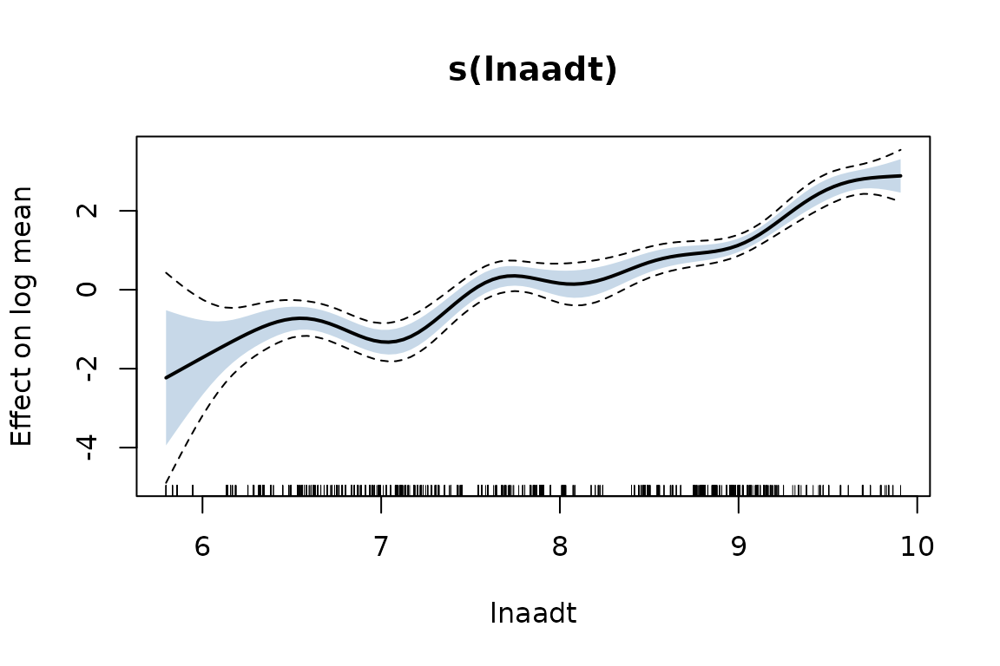
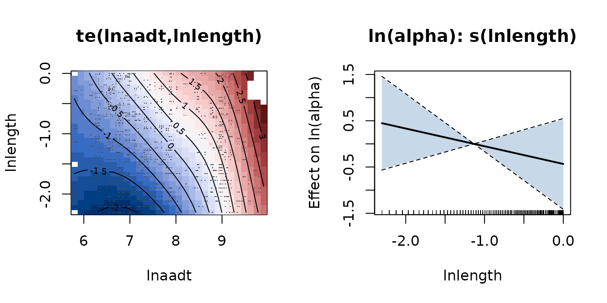
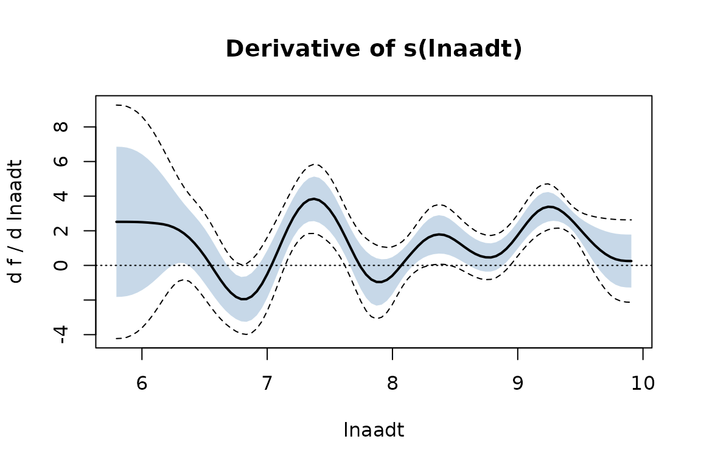

# Smooth effects: generalized additive count models

A linear term such as `lnaadt` assumes that every unit increase in log
traffic changes the log crash rate by the same amount. Often the
response bends: flat at low volumes, steep in the middle, leveling off.
A **smooth term** lets the data choose the shape, while a penalty keeps
it from following noise.

flexCountReg accepts the smooth terms of the mgcv package, `s()`,
`te()`, `ti()` and `t2()`, in the formulas of
[`countreg()`](https://jwood-iastate.github.io/flexCountReg/reference/countreg.md)
and
[`countreg_rp()`](https://jwood-iastate.github.io/flexCountReg/reference/countreg_rp.md):
the mean, the distribution parameters, the zero model and, for random
parameters, the heterogeneity in their means and variances. The model is
a *distributional* generalized additive model: any parameter of any
count family can depend smoothly on covariates.

``` r

library(flexCountReg)
data("washington_roads")
```

## 1. A smooth traffic-volume effect

``` r

m <- countreg(Total_crashes ~ s(lnaadt) + speed50 + offset(lnlength),
              data = washington_roads, family = "NB2")
summary(m)
#> Call:
#> countreg(formula = Total_crashes ~ s(lnaadt) + speed50 + offset(lnlength), 
#>     data = washington_roads, family = "NB2")
#> 
#> Model: countreg | family: NB2 | optimizer: BFGS
#> Iterations: 6 
#> Convergence: successful convergence 
#> 
#> Coefficients (standard errors: Bayesian (penalized Hessian)):
#>             Estimate Std. Error z value Pr(>|z|)    
#> (Intercept)   -0.243      0.068   -3.58  0.00035 ***
#> speed50       -0.450      0.112   -4.02  5.8e-05 ***
#> ln(alpha)     -1.384      0.305   -4.54  5.6e-06 ***
#> ---
#> Signif. codes:  0 '***' 0.001 '**' 0.01 '*' 0.05 '.' 0.1 ' ' 1
#> Offset: offset(lnlength) (coefficient fixed at 1)
#> 
#> Smooth terms (approximate tests):
#>            edf k  lambda Chi.sq p-value
#> s(lnaadt) 7.85 9 0.00734 499.09  <2e-16
#> Total effective degrees of freedom: 10.85 
#> 
#> Log-likelihood: -1055.656 | AIC: 2133.014 | BIC: 2190.677 
#> N: 1501
```

The smooth is summarized by its **effective degrees of freedom** (EDF):
1 for a straight line, up to the basis dimension `k - 1` for an
unpenalized curve. Its coefficients are not shown one by one: they only
describe the curve together. The test is an approximate test that the
whole smooth is zero.

[`plot_smooths()`](https://jwood-iastate.github.io/flexCountReg/reference/plot_smooths.md)
shows each smooth on the scale of its linear predictor, with a pointwise
band (shaded) and a simultaneous band (dashed) that covers the whole
curve with 95% probability:

``` r

plot_smooths(m)
```



[`smooth_estimates()`](https://jwood-iastate.github.io/flexCountReg/reference/smooth_estimates.md)
returns the same values as a data frame, for your own plots or tables:

``` r

head(smooth_estimates(m, n = 50, seed = 1))
#>   parameter      term   lnaadt       fit        se       lwr        upr
#> 1      mean s(lnaadt) 5.796058 -2.231157 0.8738461 -3.943864 -0.5184504
#> 2      mean s(lnaadt) 5.879952 -2.019996 0.7028794 -3.397614 -0.6423776
#> 3      mean s(lnaadt) 5.963846 -1.809243 0.5445206 -2.876484 -0.7420022
#> 4      mean s(lnaadt) 6.047741 -1.600164 0.4097921 -2.403341 -0.7969857
#> 5      mean s(lnaadt) 6.131635 -1.394872 0.3096440 -2.001763 -0.7879805
#> 6      mean s(lnaadt) 6.215530 -1.196342 0.2476097 -1.681648 -0.7110357
#>        slwr       supr
#> 1 -4.882010  0.4196950
#> 2 -4.152213  0.1122210
#> 3 -3.461071 -0.1574147
#> 4 -2.843287 -0.3570403
#> 5 -2.334191 -0.4555523
#> 6 -1.947477 -0.4452064
```

## 2. How smooth?

The amount of smoothing is chosen automatically. For each smooth a
smoothing parameter \\\lambda\\ multiplies its wiggliness penalty
\\b'Sb\\, and the model maximizes

\\ \ell(\theta) - \tfrac{1}{2} \sum_j \lambda_j b_j' S_j b_j . \\

The \\\lambda_j\\ are selected by generalized Fellner-Schall updates
(Wood and Fasiolo 2017), which approximately maximize the restricted
marginal likelihood (REML). They are stored in the fit, and `sp` fixes
them:

``` r

m$model$smooth_lambda
#> [1] 0.007341266
stiff <- countreg(Total_crashes ~ s(lnaadt) + speed50 + offset(lnlength),
                  data = washington_roads, family = "NB2", sp = 100)
stiff$model$smooth_table[, c("term", "edf", "lambda")]
#>        term      edf lambda
#> 1 s(lnaadt) 1.090613    100
```

A large \\\lambda\\ shrinks the smooth to its unpenalized part (here a
straight line). The log-likelihood’s degrees of freedom are the total
EDF, so [`AIC()`](https://rdrr.io/r/stats/AIC.html) compares smooth and
parametric models fairly:

``` r

lin <- countreg(Total_crashes ~ lnaadt + speed50 + offset(lnlength),
                data = washington_roads, family = "NB2", method = "BFGS")
c(linear = AIC(lin), smooth = AIC(m))
#>   linear   smooth 
#> 2189.118 2133.014
```

## 3. Smooth distribution parameters and surfaces

Any distribution parameter can be smooth. Here the NB2 dispersion may
vary smoothly with segment length, and traffic and length interact
through a tensor-product surface `te()`:

``` r

m2 <- countreg(Total_crashes ~ te(lnaadt, lnlength) + speed50,
               data = washington_roads, family = "NB2",
               dis_param_formula_1 = ~ s(lnlength, k = 5))
m2$model$smooth_table[, c("parameter", "term", "edf", "p.value")]
#>   parameter                term      edf      p.value
#> 1      mean te(lnaadt,lnlength) 7.929393 1.617836e-89
#> 2 ln(alpha)         s(lnlength) 1.000000 3.758677e-01
```

``` r

op <- par(mfrow = c(1, 2))
plot_smooths(m2)
```



``` r

par(op)
```

The dispersion smooth has shrunk to a straight line (EDF 1): there is no
evidence that the overdispersion changes nonlinearly with length.

## 4. Smooths with random parameters

[`countreg_rp()`](https://jwood-iastate.github.io/flexCountReg/reference/countreg_rp.md)
accepts smooth terms in its fixed part and in the heterogeneity
formulas. Three ideas look alike but are different:

- a **random parameter** (`rpar_formula`) is a coefficient that varies
  across sites with an unknown distribution, integrated by simulation;
- a **smooth** is a nonlinear function of an observed variable;
- a **smooth heterogeneity in means** (`het_mean_formula = ~ s(z)`) lets
  a random parameter’s mean change smoothly with an observed site
  attribute.

They can be combined:

``` r

rp <- countreg_rp(Total_crashes ~ s(lnaadt, k = 8) + offset(lnlength),
                  rpar_formula = ~ -1 + speed50, data = washington_roads,
                  family = "NB2", group_var = "ID", ndraws = 50)
summary(rp)
#> Call:
#> countreg_rp(formula = Total_crashes ~ s(lnaadt, k = 8) + offset(lnlength), 
#>     rpar_formula = ~-1 + speed50, data = washington_roads, family = "NB2", 
#>     ndraws = 50, group_var = "ID")
#> 
#> Model: countreg_rp | family: NB2 | optimizer: BFGS
#> Iterations: 22 
#> Convergence: successful convergence 
#> 
#> Coefficients (standard errors: Bayesian (penalized Hessian)):
#>                Estimate Std. Error z value Pr(>|z|)    
#> (Intercept)     -0.1948     0.0662   -2.94   0.0032 ** 
#> speed50:Mean    -0.5965     0.1425   -4.19  2.8e-05 ***
#> speed50:St.Dev   0.4737     0.1961    2.42   0.0157 *  
#> ln(alpha)       -1.3819     0.3148   -4.39  1.1e-05 ***
#> ---
#> Signif. codes:  0 '***' 0.001 '**' 0.01 '*' 0.05 '.' 0.1 ' ' 1
#> Offset: offset(lnlength) (coefficient fixed at 1)
#> 
#> Smooth terms (approximate tests):
#>            edf k lambda Chi.sq p-value
#> s(lnaadt) 5.13 7 0.0742 524.43  <2e-16
#> Total effective degrees of freedom: 9.13 
#> 
#> Log-likelihood: -1067.197 | AIC: 2152.647 | BIC: 2191.24 
#> N: 1501 | panels: 507
```

A smooth can absorb heterogeneity that a random parameter’s standard
deviation would otherwise carry, so compare the random parameters’
standard deviations with and without the smooth. Smooth terms are not
allowed in `rpar_formula`: a random coefficient on each basis column is
not a penalized smooth.

## 5. Smooths in random-effects panel models

The random-effects panel models
[`renb()`](https://jwood-iastate.github.io/flexCountReg/reference/renb.md),
[`repois()`](https://jwood-iastate.github.io/flexCountReg/reference/repois.md),
[`poislind_re()`](https://jwood-iastate.github.io/flexCountReg/reference/poisLindRE.md)
and
[`negmultinom()`](https://jwood-iastate.github.io/flexCountReg/reference/negmultinom.md)
accept smooth terms in the same way, with the panels as the independent
units:

``` r

re <- repois(Total_crashes ~ s(lnaadt, k = 8) + speed50 + offset(lnlength),
             group_var = "ID", data = washington_roads)
re$model$smooth_table[, c("term", "edf", "lambda", "p.value")]
#>        term      edf lambda      p.value
#> 1 s(lnaadt) 4.986079 0.0718 4.214872e-71
```

Fixed-effects models
([`countreg_fe()`](https://jwood-iastate.github.io/flexCountReg/reference/countreg_fe.md))
accept smooths of variables that change within units, such as
`s(lnaadt)`. A smooth of a variable that is constant within units is
absorbed by the fixed effects, and is refused.

Finite mixtures and latent-class models
([`countreg_mix()`](https://jwood-iastate.github.io/flexCountReg/reference/countreg_mix.md),
[`countreg_lc()`](https://jwood-iastate.github.io/flexCountReg/reference/countreg_mix.md))
give each component its own smooth, and the class membership can also be
smooth (`mixing_formula = ~ s(x)`, or `membership_formula` in
[`countreg_lc()`](https://jwood-iastate.github.io/flexCountReg/reference/countreg_mix.md)):

``` r

mx <- countreg_mix(Total_crashes ~ s(lnaadt, k = 8) + offset(lnlength),
                   data = washington_roads, family = "POISSON",
                   components = 2, n_starts = 3, seed = 1)
mx$model$smooth_table[, c("parameter", "term", "edf", "lambda")]
#>         parameter      term      edf lambda
#> 1 Component1:mean s(lnaadt) 5.257868  0.063
#> 2 Component2:mean s(lnaadt) 1.000000 356000
```

## 6. Inference and agreement with mgcv

Standard errors are Bayesian by default: the covariance of the estimates
is \\(H + S\_\lambda)^{-1}\\, with \\H\\ the negative Hessian of the
log-likelihood and \\S\_\lambda\\ the total penalty. Robust
(`stderr = "robust"`) and cluster-robust (`cluster = ~ site`) versions
use the same bread.

With the smoothing parameters fixed at those of
[`mgcv::gam()`](https://rdrr.io/pkg/mgcv/man/gam.html), the estimates,
log-likelihood, EDF and standard errors equal mgcv’s for the Poisson and
negative binomial models (with the dispersion fixed). The selected
smoothing parameters are close to mgcv’s REML values (within about 5% in
these data); the Fellner-Schall update ignores how the Hessian changes
with \\\lambda\\, which REML includes.

The tests of smooth terms are approximate (they follow Wood 2013 but
ignore the uncertainty in \\\lambda\\), and the log-likelihood’s degrees
of freedom are the EDF without the smoothing-parameter correction that
[`mgcv::logLik.gam()`](https://rdrr.io/pkg/mgcv/man/logLik.gam.html)
adds.

## 7. More kinds of smooth

Any smooth class of mgcv can be used. Some that are often useful for
count data:

- `s(lnaadt, by = speed_group)`, with a factor `by`: a separate curve
  for each level (include the factor itself as a main effect);
- `s(year, by = lnaadt)`, with a numeric `by`: a **varying
  coefficient**, the effect of `lnaadt` changing smoothly over the
  years;
- `s(site, bs = "re")`: Gaussian random intercepts for the levels of a
  factor, written as a penalized smooth;
- `s(lnaadt, corridor, bs = "fs")`: each corridor’s own curve, shrunk
  towards a common one;
- `s(zone, bs = "mrf", xt = list(nb = nb))`: a spatial effect of areas
  that is smoothed between neighboring areas (`nb` lists each area’s
  neighbors).

``` r

washington_roads$speed_group <- factor(washington_roads$speed50,
                                       labels = c("other", "50 mph"))
mb <- countreg(Total_crashes ~ s(lnaadt, by = speed_group, k = 6) +
                 speed_group + offset(lnlength),
               data = washington_roads, family = "NB2")
mb$model$smooth_table[, c("term", "edf", "p.value")]
#>                          term      edf       p.value
#> 1  s(lnaadt):speed_groupother 3.204187 1.033674e-103
#> 2 s(lnaadt):speed_group50 mph 3.450732  2.108118e-13
```

``` r

op <- par(mfrow = c(1, 2))
plot_smooths(mb)
```


``` r

par(op)
```

## 8. Checking smooth terms

**Basis dimension.** Each smooth has a maximum flexibility set by `k`.
[`smooth_check()`](https://jwood-iastate.github.io/flexCountReg/reference/smooth_check.md)
compares the residuals of neighboring observations, ordered by the
smooth’s covariate, with the overall residual variance. It uses the
randomized quantile residuals, which are standard normal for a correct
count model. A k-index clearly below 1 with a small p-value means the
residuals still follow the covariate, and a larger `k` should be tried:

``` r

small <- countreg(Total_crashes ~ s(lnaadt, k = 4) + offset(lnlength),
                  data = washington_roads, family = "NB2")
smooth_check(small)
#>   parameter      term k      edf   k_index p_value residuals
#> 1      mean s(lnaadt) 3 2.770066 0.9348829   0.005  quantile
```

**Concurvity.**
[`concurvity_fcr()`](https://jwood-iastate.github.io/flexCountReg/reference/concurvity_fcr.md)
reports how much of each smooth the other terms of its linear predictor
can reproduce (0 to 1). Values near 1 mean the smooth’s shape is poorly
determined.

``` r

concurvity_fcr(m2)
#>   parameter                term     observed        worst
#> 1      mean te(lnaadt,lnlength) 8.587255e-04 1.063128e-01
#> 2 ln(alpha)         s(lnlength) 3.576806e-33 3.247650e-29
```

**Derivatives.**
[`plot_derivatives()`](https://jwood-iastate.github.io/flexCountReg/reference/plot_derivatives.md)
shows where a smooth is increasing or decreasing, with pointwise and
simultaneous bands:

``` r

plot_derivatives(m)
```



**Calibration.** A smooth can fit the mean and still miss the zeros or
the dispersion.
[`calibration_by()`](https://jwood-iastate.github.io/flexCountReg/reference/calibration_by.md)
compares observed and predicted means, probabilities of zero and
variances within quantile groups of a covariate:

``` r

calibration_by(m, "lnaadt", groups = 5)
#>         group   n observed_mean predicted_mean observed_p0 predicted_p0
#> 1  [5.8,6.73] 301    0.14285714     0.13276194   0.8671096    0.8812940
#> 2 (6.73,7.22] 301    0.08305648     0.08516662   0.9335548    0.9208793
#> 3 (7.22,7.89] 299    0.24414716     0.25214260   0.8026756    0.7997339
#> 4 (7.89,8.93] 317    0.51419558     0.51932265   0.6593060    0.6527419
#> 5 (8.93,9.91] 283    1.38162544     1.41277532   0.3886926    0.4046796
#>   observed_var predicted_var
#> 1    0.1428571     0.1465752
#> 2    0.1164120     0.0909499
#> 3    0.2992525     0.3223760
#> 4    0.7062852     0.7733261
#> 5    2.8396612     3.5483789
```

Two-variable smooths can be drawn as surfaces masked away from the data
with
[`plot_surface()`](https://jwood-iastate.github.io/flexCountReg/reference/plot_surface.md).

## 9. Not yet available

Bootstrap standard errors with smooth terms are not yet available.

## References

Ruppert, D., Wand, M.P. and Carroll, R.J. (2003). *Semiparametric
Regression*. Cambridge University Press.

Wood, S.N. (2013). On p-values for smooth components of an extended
generalized additive model. *Biometrika*, 100(1), 221-228.

Wood, S.N. and Fasiolo, M. (2017). A generalized Fellner-Schall method
for smoothing parameter optimization with application to Tweedie
location, scale and shape models. *Biometrics*, 73(4), 1071-1081.
