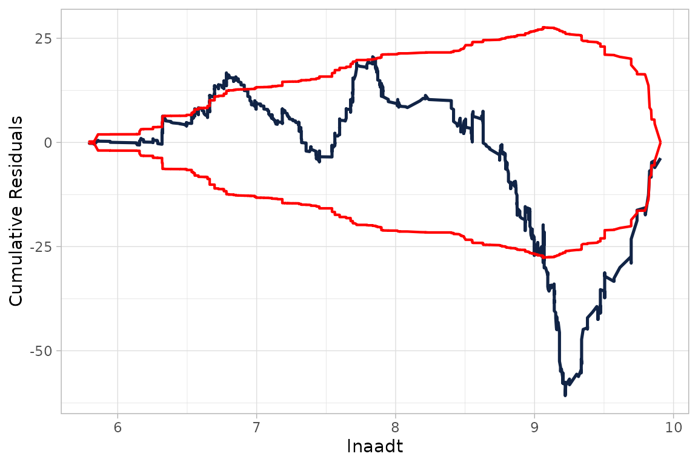

# Count models with tidymodels

[tidymodels](https://www.tidymodels.org/) is a family of packages for
building, resampling, tuning and comparing models with one interface.
flexCountReg plugs into it through **parsnip**:
[`count_reg()`](https://jwood-iastate.github.io/flexCountReg/reference/count_reg.md)
is a model specification, and every estimator of the package is one of
its *engines*. A negative binomial regression, a latent-class model and
a random-effects model can then share the same preprocessing, the same
resamples and the same metrics.

This article covers fitting and predicting, recipes and workflows,
offsets and other special columns, comparing and tuning models, weights,
panel models, several outcomes, and getting back to the functions of
flexCountReg.

``` r

library(parsnip)
library(recipes)
library(workflows)
library(workflowsets)
library(rsample)
library(tune)
library(yardstick)
library(flexCountReg)

data("washington_roads")
roads <- tibble::as_tibble(washington_roads)
roads$ID <- as.character(roads$ID)
```

[`library(tidymodels)`](https://tidymodels.tidymodels.org) loads all of
these except flexCountReg at once. The data have three years of crashes
on each road segment, identified by `ID`.

## A first model

Choose the distribution with `family`, the estimator with
[`set_engine()`](https://parsnip.tidymodels.org/reference/set_engine.html),
and fit. Arguments of the estimator go into
[`set_engine()`](https://parsnip.tidymodels.org/reference/set_engine.html).

``` r

nb_spec <- count_reg(family = "NB2") |>
  set_engine("flexCountReg", method = "BFGS")

nb_fit <- fit(nb_spec, Total_crashes ~ lnaadt + lnlength + speed50,
              data = roads)
tidy(nb_fit)
#> # A tibble: 5 × 6
#>   term        component    estimate std.error statistic  p.value
#>   <chr>       <chr>           <dbl>     <dbl>     <dbl>    <dbl>
#> 1 (Intercept) mean           -8.77     0.439     -20.0  1.08e-88
#> 2 lnaadt      mean            1.08     0.0518     20.9  3.81e-97
#> 3 lnlength    mean            0.762    0.0694     11.0  4.74e-28
#> 4 speed50     mean           -0.537    0.108      -4.98 6.32e- 7
#> 5 ln(alpha)   distribution   -1.04     0.249      -4.20 2.64e- 5
glance(nb_fit)
#> # A tibble: 1 × 10
#>   model    family logLik   AIC   BIC    df  nobs n_groups converged vcov_type
#>   <chr>    <chr>   <dbl> <dbl> <dbl> <int> <int>    <int> <lgl>     <chr>    
#> 1 countreg NB2    -1085. 2180. 2206.     5  1501       NA TRUE      hessian
```

Predictions are tibbles with one row per row of `new_data`:

``` r

new_roads <- roads[1:4, ]
predict(nb_fit, new_roads)
#> # A tibble: 4 × 1
#>   .pred
#>   <dbl>
#> 1 0.780
#> 2 0.710
#> 3 1.04 
#> 4 0.332
predict(nb_fit, new_roads, type = "conf_int")
#> # A tibble: 4 × 2
#>   .pred_lower .pred_upper
#>         <dbl>       <dbl>
#> 1       0.643       0.943
#> 2       0.584       0.859
#> 3       0.847       1.27 
#> 4       0.260       0.411
predict(nb_fit, new_roads, type = "pred_int", level = 0.9)
#> # A tibble: 4 × 2
#>   .pred_lower .pred_upper
#>         <dbl>       <dbl>
#> 1           0           3
#> 2           0           3
#> 3           0           3
#> 4           0           2
augment(nb_fit, new_roads)[, c(".pred", ".resid", "Total_crashes")]
#> # A tibble: 4 × 3
#>   .pred .resid Total_crashes
#>   <dbl>  <dbl>         <int>
#> 1 0.780 -0.780             0
#> 2 0.710  1.29              2
#> 3 1.04   0.957             2
#> 4 0.332 -0.332             0
```

`conf_int` is an interval for the expected count, `pred_int` for a
future count. Everything else that
[`predict()`](https://rdrr.io/r/stats/predict.html) offers is available
with `type = "raw"` and `opts`, such as the probabilities of 0 to 3
crashes:

``` r

predict(nb_fit, new_roads, type = "raw",
        opts = list(type = "prob", max_count = 3, overflow = TRUE))
#>           0      1       2        3       >3
#> [1,] 0.5020 0.3072 0.12707 0.044160 0.019553
#> [2,] 0.5307 0.3014 0.11571 0.037318 0.014906
#> [3,] 0.4112 0.3138 0.16187 0.070148 0.042947
#> [4,] 0.7307 0.2171 0.04358 0.007352 0.001308
```

## The engines

``` r

show_engines("count_reg")
#> # A tibble: 12 × 2
#>    engine         mode      
#>    <chr>          <chr>     
#>  1 flexCountReg   regression
#>  2 countreg_rp    regression
#>  3 countreg_mix   regression
#>  4 countreg_lc    regression
#>  5 countreg_fe    regression
#>  6 countreg_hier  regression
#>  7 countreg_alloc regression
#>  8 countreg_mv    regression
#>  9 renb           regression
#> 10 repois         regression
#> 11 poislind_re    regression
#> 12 negmultinom    regression
```

| Engine | Estimator | Typical engine arguments |
|:---|:---|:---|
| `flexCountReg` | [`countreg()`](https://jwood-iastate.github.io/flexCountReg/reference/countreg.md) | `dis_param_formula_1`, `zero_formula`, `underreport_formula`, `offset` |
| `countreg_rp` | [`countreg_rp()`](https://jwood-iastate.github.io/flexCountReg/reference/countreg_rp.md) | `rpar_formula`, `rpardists`, `ndraws`, `group_var` |
| `countreg_mix` | [`countreg_mix()`](https://jwood-iastate.github.io/flexCountReg/reference/countreg_mix.md) | `components`, `mixing_formula` |
| `countreg_lc` | [`countreg_lc()`](https://jwood-iastate.github.io/flexCountReg/reference/countreg_mix.md) | `classes`, `membership_formula`, `group_var` |
| `countreg_fe` | [`countreg_fe()`](https://jwood-iastate.github.io/flexCountReg/reference/countreg_fe.md) | `fixef` |
| `countreg_hier` | [`countreg_hier()`](https://jwood-iastate.github.io/flexCountReg/reference/countreg_hier.md) | `re_dist`, `fit_engine` |
| `countreg_alloc` | [`countreg_alloc()`](https://jwood-iastate.github.io/flexCountReg/reference/countreg_alloc.md) | `alloc_formula`, `link` |
| `countreg_mv` | [`countreg_mv()`](https://jwood-iastate.github.io/flexCountReg/reference/countreg_mv.md) | `copula`, `rpar_formula` |
| `renb`, `repois`, `poislind_re` | the function of that name | `group_var` |
| `negmultinom` | [`negmultinom()`](https://jwood-iastate.github.io/flexCountReg/reference/negmultinom.md) | `group_var` |

Two engine arguments belong to the tidymodels interface:

- `predict_args` is a list of arguments for the model’s
  [`predict()`](https://rdrr.io/r/stats/predict.html) method, used for
  numeric predictions, for example
  `predict_args = list(method = "Exact")` for random parameters.
- `fit_engine` is the estimators’ own `engine` argument (the numerical
  method), because
  [`set_engine()`](https://parsnip.tidymodels.org/reference/set_engine.html)
  already has an argument of that name.

## Recipes and workflows

A **workflow** bundles preprocessing with the model. Here a recipe
centers and scales the numeric predictors and makes indicators of a
factor; the statistics are estimated on the training data only.

``` r

roads$year <- factor(roads$Year)
set.seed(2026)
split <- group_initial_split(roads, group = ID, prop = 0.75)
train <- training(split)
test <- testing(split)

rec <- recipe(Total_crashes ~ lnaadt + lnlength + speed50 + year,
              data = train) |>
  step_normalize(lnaadt, lnlength) |>
  step_dummy(year)

nb_wf <- workflow() |>
  add_recipe(rec) |>
  add_model(nb_spec)
nb_wf_fit <- fit(nb_wf, train)
tidy(nb_wf_fit)
#> # A tibble: 7 × 6
#>   term        component    estimate std.error statistic  p.value
#>   <chr>       <chr>           <dbl>     <dbl>     <dbl>    <dbl>
#> 1 (Intercept) mean           -1.12     0.104     -10.8  5.33e-27
#> 2 lnaadt      mean            1.11     0.0605     18.3  1.30e-74
#> 3 lnlength    mean            0.532    0.0536      9.94 2.82e-23
#> 4 speed50     mean           -0.556    0.125      -4.45 8.41e- 6
#> 5 year_X2017  mean           -0.182    0.124      -1.47 1.42e- 1
#> 6 year_X2018  mean           -0.155    0.122      -1.27 2.04e- 1
#> 7 ln(alpha)   distribution   -1.05     0.281      -3.75 1.79e- 4

augment(nb_wf_fit, test) |>
  rmse(truth = Total_crashes, estimate = .pred)
#> # A tibble: 1 × 3
#>   .metric .estimator .estimate
#>   <chr>   <chr>          <dbl>
#> 1 rmse    standard       0.734
```

The split keeps all years of a segment on one side
([`group_initial_split()`](https://rsample.tidymodels.org/reference/initial_split.html)),
so the test segments are new to the model. A random split of rows would
put years of one segment on both sides.

flexCountReg’s own
[`rmse()`](https://jwood-iastate.github.io/flexCountReg/reference/rmse.md)
and
[`mae()`](https://jwood-iastate.github.io/flexCountReg/reference/mae.md)
take two vectors; given a data frame they call the yardstick metric, so
tidymodels code works whichever package is loaded last. (With yardstick
loaded last, use
[`flexCountReg::rmse()`](https://jwood-iastate.github.io/flexCountReg/reference/rmse.md)
or
[`yardstick::rmse_vec()`](https://yardstick.tidymodels.org/reference/rmse.html)
for two vectors.)

## Offsets and other columns that are not predictors

With
[`add_formula()`](https://workflows.tidymodels.org/reference/add_formula.html)
or a recipe, all predictors enter the mean model. Count models often
need columns with another purpose: an exposure, a grouping variable, or
a covariate of the dispersion only. A workflow passes the model only its
predictors and outcomes, so these columns must be among the *predictors*
(a recipe’s other roles do not reach the model). There are two ways to
say what they are.

**Give the model formula** in
[`add_model()`](https://workflows.tidymodels.org/reference/add_model.html).
The preprocessor says which columns are available and the formula says
how they are used. All the formula features of the package work here:
[`offset()`](https://rdrr.io/r/stats/offset.html), smooths `s(x)`,
[`tv()`](https://jwood-iastate.github.io/flexCountReg/reference/tv.md)
terms and random effects.

``` r

wf_offset <- workflow() |>
  add_variables(outcomes = Total_crashes,
                predictors = c(lnaadt, lnlength, speed50)) |>
  add_model(count_reg() |>
              set_engine("flexCountReg", method = "BFGS",
                         dis_param_formula_1 = ~ lnlength),
            formula = Total_crashes ~ lnaadt + speed50 + offset(lnlength))
tidy(fit(wf_offset, train))[, 1:4]
#> # A tibble: 5 × 4
#>   term                  component    estimate std.error
#>   <chr>                 <chr>           <dbl>     <dbl>
#> 1 (Intercept)           mean           -8.68     0.510 
#> 2 lnaadt                mean            1.10     0.0591
#> 3 speed50               mean           -0.565    0.127 
#> 4 ln(alpha):(Intercept) distribution   -1.25     0.470 
#> 5 ln(alpha):lnlength    distribution   -0.372    0.390
```

A recipe works too, in place of
[`add_variables()`](https://workflows.tidymodels.org/reference/add_variables.html):

``` r

workflow() |>
  add_recipe(rec) |>
  add_model(nb_spec, formula = Total_crashes ~ s(lnaadt) + speed50)
```

**Name the columns in engine arguments**. Columns named in `offset`,
`group_var`, `panel_id`, `cluster`, `fixef`, `cre_group` or `time` are
left out of the mean model when no model formula is given. So are the
variables of `rpar_formula` with the `countreg_rp` engine, which are
random instead of fixed.

``` r

wf_offset2 <- workflow() |>
  add_formula(Total_crashes ~ lnaadt + lnlength) |>
  add_model(count_reg() |> set_engine("flexCountReg", method = "BFGS",
                                      offset = "lnlength"))
tidy(fit(wf_offset2, train))[, 1:4]
#> # A tibble: 3 × 4
#>   term        component    estimate std.error
#>   <chr>       <chr>           <dbl>     <dbl>
#> 1 (Intercept) mean           -9.24     0.507 
#> 2 lnaadt      mean            1.15     0.0590
#> 3 ln(alpha)   distribution   -0.840    0.252
```

Variables used only in `dis_param_formula_1`, `zero_formula` and similar
formulas are *not* left out, because they often belong in both places;
use a model formula for those. Do not normalize an offset or make
indicators of a grouping column in a recipe.

## Comparing models on resamples

Cross-validate with whole segments, and compare several engines in a
workflow set. The panel engines receive the segment as `group_var`.

``` r

set.seed(2026)
folds <- group_vfold_cv(train, group = ID, v = 3)

specs <- list(
  poisson = count_reg(family = "POISSON") |>
    set_engine("flexCountReg", method = "BFGS"),
  nb2 = nb_spec,
  two_class = count_reg(family = "POISSON") |>
    set_engine("countreg_lc", classes = 2, n_starts = 3, seed = 1,
               group_var = "ID"),
  re_poisson = count_reg() |>
    set_engine("repois", group_var = "ID", method = "BFGS"))

base <- workflow_set(
  preproc = list(base = Total_crashes ~ lnaadt + lnlength + speed50 + ID),
  models = specs[c("two_class", "re_poisson")])
plain <- workflow_set(
  preproc = list(base = Total_crashes ~ lnaadt + lnlength + speed50),
  models = specs[c("poisson", "nb2")])

res <- dplyr::bind_rows(base, plain) |>
  workflow_map("fit_resamples", resamples = folds,
               metrics = metric_set(rmse, mae))
rank_results(res, rank_metric = "rmse")[, c("wflow_id", ".metric", "mean",
                                            "std_err")]
#> # A tibble: 8 × 4
#>   wflow_id        .metric  mean std_err
#>   <chr>           <chr>   <dbl>   <dbl>
#> 1 base_two_class  mae     0.498  0.0294
#> 2 base_two_class  rmse    0.843  0.0946
#> 3 base_re_poisson mae     0.498  0.0261
#> 4 base_re_poisson rmse    0.850  0.0932
#> 5 base_nb2        mae     0.497  0.0261
#> 6 base_nb2        rmse    0.851  0.0934
#> 7 base_poisson    mae     0.497  0.0253
#> 8 base_poisson    rmse    0.851  0.0919
```

RMSE and MAE only look at the expected count, and models with the same
mean structure are hard to tell apart by them. To compare the
*distributions*, score the predicted probabilities, here with the
out-of-sample log-likelihood of each fold (see
[`vignette("predictive-validation", package = "flexCountReg")`](https://jwood-iastate.github.io/flexCountReg/articles/predictive-validation.md)
for scores and calibration):

``` r

log_score <- function(spec) {
  sapply(folds$splits, function(s) {
    f <- fit(spec, Total_crashes ~ lnaadt + lnlength + speed50,
             data = analysis(s))
    held_out <- assessment(s)
    p <- predict(f, held_out, type = "raw",
                 opts = list(type = "prob",
                             max_count = max(roads$Total_crashes)))
    mean(log(p[cbind(seq_len(nrow(p)), held_out$Total_crashes + 1)]))
  })
}
sapply(specs[c("poisson", "nb2")], function(s) mean(log_score(s)))
#> poisson     nb2 
#> -0.7709 -0.7518
```

## Tuning

The distribution is a tuning parameter:

``` r

tune_wf <- workflow() |>
  add_formula(Total_crashes ~ lnaadt + lnlength + speed50) |>
  add_model(count_reg(family = tune()) |>
              set_engine("flexCountReg", method = "BFGS"))

tuned <- tune_grid(tune_wf, resamples = folds,
                   grid = data.frame(family = c("POISSON", "NB1", "NB2",
                                                "PL")),
                   metrics = metric_set(rmse, mae))
show_best(tuned, metric = "rmse")
#> # A tibble: 4 × 7
#>   family  .metric .estimator  mean     n std_err .config        
#>   <chr>   <chr>   <chr>      <dbl> <int>   <dbl> <chr>          
#> 1 NB1     rmse    standard   0.850     3  0.0931 pre0_mod1_post0
#> 2 PL      rmse    standard   0.850     3  0.0937 pre0_mod3_post0
#> 3 NB2     rmse    standard   0.851     3  0.0934 pre0_mod2_post0
#> 4 POISSON rmse    standard   0.851     3  0.0919 pre0_mod4_post0

final_wf <- finalize_workflow(tune_wf, select_best(tuned, metric = "rmse"))
last_fit(final_wf, split, metrics = metric_set(rmse, mae)) |>
  collect_metrics()
#> # A tibble: 2 × 4
#>   .metric .estimator .estimate .config        
#>   <chr>   <chr>          <dbl> <chr>          
#> 1 rmse    standard       0.726 pre0_mod0_post0
#> 2 mae     standard       0.449 pre0_mod0_post0
```

Some engine arguments have tuning parameters too (see
[`?count_family`](https://jwood-iastate.github.io/flexCountReg/reference/count_family.md)):
`components` and `classes`, `zero_type`, `correlated` and `re_dist`. Any
other argument can be tuned with an explicit grid.

``` r

lc_wf <- workflow() |>
  add_formula(Total_crashes ~ lnaadt + lnlength) |>
  add_model(count_reg(family = "POISSON") |>
              set_engine("countreg_mix", components = tune(), n_starts = 2,
                         seed = 1))
hardhat::extract_parameter_set_dials(lc_wf)
tune_grid(lc_wf, folds, grid = data.frame(components = 2:3),
          metrics = metric_set(rmse)) |>
  collect_metrics()
#> # A tibble: 2 × 7
#>   components .metric .estimator  mean     n std_err .config        
#>        <int> <chr>   <chr>      <dbl> <int>   <dbl> <chr>          
#> 1          2 rmse    standard   0.839     3  0.0858 pre0_mod1_post0
#> 2          3 rmse    standard   0.843     3  0.0895 pre0_mod2_post0
```

Tuning selects for out-of-sample accuracy; the standard errors of the
selected model do not account for the selection. Some families have no
dispersion parameter, so a grid that includes `"POISSON"` fails for
those rows when `dis_param_formula_1` is set.

Use a parallel backend for slow models (`future::plan("multisession")`
before
[`tune_grid()`](https://tune.tidymodels.org/reference/tune_grid.html));
the workers load flexCountReg themselves.

## Case weights

Case weights become the estimator’s `weights`, by default frequency
weights. parsnip passes the engine only the values of the weights, so
for importance or sampling weights say so with
`weight_type = "sampling"` (`flexCountReg` and `countreg_rp` engines),
which gives robust standard errors.

``` r

train_w <- train
train_w$w <- hardhat::frequency_weights(rep(1:2, length.out = nrow(train)))
wf_w <- workflow() |>
  add_formula(Total_crashes ~ lnaadt + lnlength) |>
  add_case_weights(w) |>
  add_model(nb_spec)
tidy(fit(wf_w, train_w))[, 1:4]
#> # A tibble: 4 × 4
#>   term        component    estimate std.error
#>   <chr>       <chr>           <dbl>     <dbl>
#> 1 (Intercept) mean           -9.27     0.416 
#> 2 lnaadt      mean            1.12     0.0493
#> 3 lnlength    mean            0.765    0.0646
#> 4 ln(alpha)   distribution   -1.08     0.245
```

## Panel and hierarchical models

Random effects of
[`countreg_hier()`](https://jwood-iastate.github.io/flexCountReg/reference/countreg_hier.md)
are written in the model formula:

``` r

hier_wf <- workflow() |>
  add_variables(outcomes = Total_crashes,
                predictors = c(lnaadt, lnlength, ID)) |>
  add_model(count_reg(family = "NB2") |>
              set_engine("countreg_hier",
                         predict_args = list(marginal = TRUE)),
            formula = Total_crashes ~ lnaadt + lnlength + (1 | ID))
hier_fit <- fit(hier_wf, train)
predict(hier_fit, test[1:3, ])
#> # A tibble: 3 × 1
#>   .pred
#>   <dbl>
#> 1 1.27 
#> 2 1.03 
#> 3 0.476
```

The test segments are new groups. With `marginal = TRUE` their
predictions average over the distribution of the random effect; without
it they are for a segment whose effect is zero. The choice matters for
[`rmse()`](https://jwood-iastate.github.io/flexCountReg/reference/rmse.md),
so set it in `predict_args`. Likewise,
[`countreg_fe()`](https://jwood-iastate.github.io/flexCountReg/reference/countreg_fe.md)
has no effect for a new group and predicts `NA` unless
`predict_args = list(newgroup = "mean_fe")`.

A random-parameters model:

``` r

rp_spec <- count_reg(family = "NB2") |>
  set_engine("countreg_rp", rpar_formula = ~ -1 + lnlength,
             ndraws = 100, predict_args = list(method = "Exact"))
rp_wf <- workflow() |>
  add_formula(Total_crashes ~ lnaadt + speed50 + lnlength) |>
  add_model(rp_spec)
rp_fit <- fit(rp_wf, train)
tidy(rp_fit)[, 1:4]
#> # A tibble: 6 × 4
#>   term            component    estimate std.error
#>   <chr>           <chr>           <dbl>     <dbl>
#> 1 (Intercept)     mean           -8.61     0.502 
#> 2 lnaadt          mean            1.07     0.0589
#> 3 speed50         mean           -0.556    0.125 
#> 4 lnlength:Mean   random_mean     0.822    0.101 
#> 5 lnlength:St.Dev random_scale    0.177    0.160 
#> 6 ln(alpha)       distribution   -1.16     0.389
predict(rp_fit, test[1:3, ])
#> # A tibble: 3 × 1
#>   .pred
#>   <dbl>
#> 1 0.800
#> 2 0.655
#> 3 0.312
```

## Several outcomes

[`countreg_mv()`](https://jwood-iastate.github.io/flexCountReg/reference/countreg_mv.md)
and
[`countreg_alloc()`](https://jwood-iastate.github.io/flexCountReg/reference/countreg_alloc.md)
model several counts. Declare all of them as outcomes and give the model
formula. There is one prediction column per outcome.

``` r

set.seed(1)
sev <- train
sev$injury <- rbinom(nrow(sev), sev$Total_crashes, 0.35)
sev$pdo <- sev$Total_crashes - sev$injury

mv_wf <- workflow() |>
  add_variables(outcomes = c(injury, pdo),
                predictors = c(lnaadt, lnlength)) |>
  add_model(count_reg(family = "NB2") |>
              set_engine("countreg_mv", copula = "frank"),
            formula = cbind(injury, pdo) ~ lnaadt + lnlength)
mv_fit <- fit(mv_wf, sev)
predict(mv_fit, sev[1:3, ])
#> # A tibble: 3 × 2
#>   .pred_injury .pred_pdo
#>          <dbl>     <dbl>
#> 1        0.403     0.805
#> 2        0.366     0.730
#> 3        0.542     1.09
```

(The severities here are simulated.) The resampling functions of tune
compute metrics for a single outcome, so validate these models with a
loop over rsample splits:

``` r

mv_folds <- group_vfold_cv(sev, group = ID, v = 3)
do.call(rbind, lapply(mv_folds$splits, function(s) {
  f <- fit(mv_wf, analysis(s))
  a <- augment(f, assessment(s))
  data.frame(injury = rmse_vec(a$injury, a$.pred_injury),
             pdo = rmse_vec(a$pdo, a$.pred_pdo))
})) |> colMeans()
#> injury    pdo 
#> 0.4114 0.6455
```

## Back to flexCountReg

[`extract_fit_engine()`](https://hardhat.tidymodels.org/reference/hardhat-extract.html)
returns the flexCountReg model, for everything that tidymodels has no
interface for: marginal effects, CURE plots, rootograms, robust
covariances, model tests.

``` r

m <- extract_fit_engine(fit(wf_offset, train))
margEffTable(m)
#> Marginal Effects / Elasticities
#> Method: delta 
#> 
#>     term variable_type           effect_metric estimate std_error t_value
#>   lnaadt    continuous Average marginal effect    0.531     0.044   12.08
#>  speed50     indicator   Pseudo-elasticity (%)  -43.167     7.195   -6.00
#>  p_value sig lower_ci upper_ci n_obs successful_bootstraps
#>        0 ***    0.445    0.617  1125                    NA
#>        0 ***  -57.268  -29.065  1125                    NA
cureplot(m, indvar = "lnaadt")
```



``` r

sqrt(diag(vcov(m, type = "robust")))[1:3]
#> (Intercept)      lnaadt     speed50 
#>      0.5780      0.0668      0.1370
```

Keep in mind:

- Without a model formula the outcome is called `..y` in the extracted
  model; with one it keeps its name.
- The extracted model sees the *preprocessed* columns. Marginal effects
  after
  [`step_normalize()`](https://recipes.tidymodels.org/reference/step_normalize.html)
  are per standard deviation.
- A workflow removes the outcome from `new_data`. Predictions that use
  it, such as Empirical Bayes predictions
  (`predict(m, newdata, method = "Individual")`) or posterior class
  probabilities, need the extracted model.
- `keep_data = FALSE` (an engine argument of most estimators) makes
  saved models smaller, at the cost of the functions that need the
  training data.
- Load flexCountReg before using a saved workflow: that registers the
  engines.
