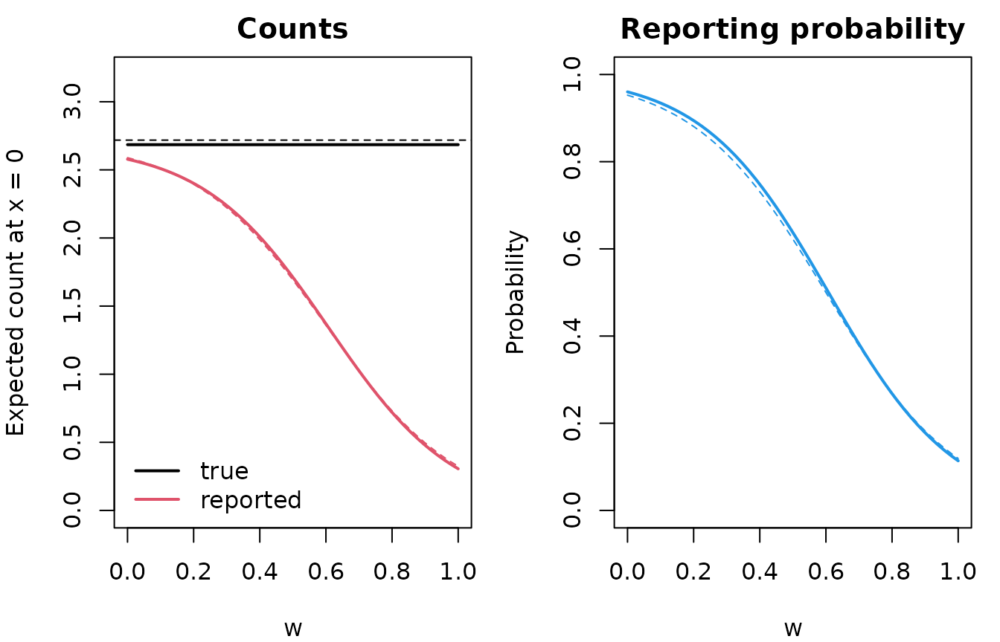

# Underreporting: observed counts, true counts and identification

Many recorded counts miss events: crashes without injuries are not all
reported to the police, and not every case of a disease reaches a
surveillance system. An underreporting model separates the expected
*true* count from the probability that an event is *reported*. This
vignette shows what such a model estimates, what information lets the
data separate the two parts, and what happens when that information is
weak. All data here are simulated, so the truth is known; with real
data, the true counts and reporting rates are not observed, and their
estimates rest on the assumptions described below.

``` r

library(flexCountReg)
```

## The model

The true count \\Y\\ follows a count distribution with mean \\\mu =
\exp(X\beta)\\. Each event is reported independently with probability
\\p = F(Z\gamma)\\, where \\F\\ is the logistic
(`underreport_family = "logit"`, the default) or normal (`"probit"`)
distribution function. The reported count is a binomial thinning of the
true count:

\\Y^\* \mid Y \sim \mathrm{Binomial}(Y, p), \qquad E\[Y^\*\] = p\\\mu.\\

For the families that allow it
([`?count_families`](https://jwood-iastate.github.io/flexCountReg/reference/count_families.md)
lists them and the variance of the reported counts), the reported counts
follow the same family with mean \\p\mu\\. The fitted model reports
three quantities:

| `predict(type = )` | Quantity                         |
|--------------------|----------------------------------|
| `"response"`       | expected reported count \\p\mu\\ |
| `"true"`           | expected true count \\\mu\\      |
| `"prob_reported"`  | reporting probability \\p\\      |

`zero_formula` and `underreport_formula` cannot be combined: both act on
the zeros.

## What the reported counts cannot tell apart

The reported counts depend on the two parts only through the product
\\p\mu\\. With a constant reporting probability, \\p\\\exp(\beta_0)\\ is
all the data can identify: a lower true rate with complete reporting and
a higher true rate with incomplete reporting give exactly the same
reported counts. flexCountReg refuses this model:

``` r

set.seed(1)
toy <- data.frame(x = rnorm(200))
toy$y <- rpois(200, exp(0.5 + 0.3 * toy$x))
res <- tryCatch(
  countreg(y ~ x, data = toy, family = "NB2", underreport_formula = ~ 1),
  error = function(e) conditionMessage(e))
cat(strwrap(res), sep = "\n")
#> An intercept-only `underreport_formula` is not identified: a constant
#> reporting probability p and the count-model intercept b0 enter the
#> likelihood only through exp(b0) * p. Add variables that affect
#> reporting but not the true counts, or analyze the reported counts
#> without an underreporting model.
```

Separating the two parts needs information about reporting that does not
also act on the true counts. In practice that information comes from:

- **an exclusion restriction**: a variable that changes the reporting
  probability but not the true count (for example, the reporting
  practice of the agency that records the events), justified by subject
  knowledge;
- **the functional form** of the link: with a logit or probit link, the
  reported mean is not log-linear in the reporting variables, and the
  curvature carries some information about the *level* of \\p\\;
- **external information**, such as known reporting probabilities or a
  validation study of true counts.

A different predictor list in the two formulas is necessary, but it does
not by itself make the model identified, as the simulations below show.

## A simulation with known truth

The true count is NB2 with mean \\\exp(1 + 0.5x)\\ and dispersion
\\\alpha = 0.5\\. A reporting variable \\w \sim U(0, 1)\\ affects only
the reporting probability, \\p = \mathrm{logit}^{-1}(\gamma_0 + \gamma_1
w)\\. Two designs differ in how much the reporting probability varies:

``` r

simulate_reports <- function(n, seed, gamma) {
  set.seed(seed)
  x <- rnorm(n)
  w <- runif(n)
  mu <- exp(1 + 0.5 * x)
  p <- plogis(gamma[1] + gamma[2] * w)
  y_true <- rnbinom(n, size = 2, mu = mu)
  data.frame(x, w, y_true, y = rbinom(n, y_true, p), mu, p)
}
designs <- list(weak = c(1.5, -2), strong = c(3, -5))
sapply(designs, function(g) round(plogis(g[1] + g[2] * c(w0 = 0, w1 = 1)), 2))
#>    weak strong
#> w0 0.82   0.95
#> w1 0.38   0.12
```

In the *weak* design the reporting probability runs from 0.82 down to
0.38; in the *strong* design it runs from 0.95, nearly complete
reporting, down to 0.12.

### One sample from each design

``` r

fits <- lapply(designs, function(g) {
  d <- simulate_reports(2000, seed = 8, gamma = g)
  countreg(y ~ x, data = d, family = "NB2", underreport_formula = ~ w,
           method = "BFGS")
})
#> Warning: The underreporting model is weakly identified: the estimates of
#> Underreporting:(Intercept) and (Intercept) have correlation -0.994. The data
#> barely separate the true count mean from the reporting probability; interpret
#> the true-count estimates with caution, and consider reporting variables that do
#> not affect the true counts or external validation data.
lapply(fits, function(m) round(summary(m)$coefficients[, 1:2], 3))
#> $weak
#>                            Estimate Std. Error
#> (Intercept)                   1.089      0.337
#> x                             0.541      0.024
#> ln(alpha)                    -0.711      0.075
#> Underreporting:(Intercept)    1.201      1.237
#> Underreporting:w             -1.936      0.836
#> 
#> $strong
#>                            Estimate Std. Error
#> (Intercept)                   0.988      0.063
#> x                             0.517      0.025
#> ln(alpha)                    -0.694      0.076
#> Underreporting:(Intercept)    3.182      0.493
#> Underreporting:w             -5.234      0.535
```

The truth is \\\beta_0 = 1\\, \\\beta_x = 0.5\\ and \\(\gamma_0,
\gamma_1)\\ = (1.5, -2) or (3, -5). In both designs, the effect of \\x\\
on the true count is estimated precisely: it is identified whether or
not the reporting model is right, because \\x\\ does not enter the
reporting model. The split between the true-count level and the
reporting level is the hard part. In the weak design the standard errors
of the two intercepts are large: the logit curve over the range of \\w\\
is close to log-linear, so a log-linear effect of \\w\\ on the reported
mean fits almost as well. In the strong design, the reporting
probability approaches 1 for small \\w\\, and the flattening of the
curve there pins down its level.

### Recovery over replicates

One sample can be lucky or unlucky. Twenty replicate samples of 2,000
rows from each design give the following estimates (an illustration, not
a full simulation study):

``` r

recover_one <- function(seed, gamma) {
  d <- simulate_reports(2000, seed, gamma)
  warned <- FALSE
  m <- tryCatch(withCallingHandlers(
    countreg(y ~ x, data = d, family = "NB2", underreport_formula = ~ w,
             method = "BFGS"),
    warning = function(w) {
      warned <<- TRUE
      invokeRestart("muffleWarning")
    }), error = function(e) NULL)
  if (is.null(m) || !isTRUE(m$model$converged)) {
    return(c(NA, NA, NA, NA, converged = 0, warned = warned))
  }
  co <- coef(m)[c("(Intercept)", "x", "Underreporting:(Intercept)",
                  "Underreporting:w")]
  c(co, converged = 1, warned = warned)
}
recovery <- lapply(designs, function(g)
  t(sapply(101:120, recover_one, gamma = g)))
truth <- function(g) c(1, 0.5, g)
recovery_table <- do.call(rbind, lapply(names(designs), function(k) {
  r <- recovery[[k]]
  ok <- r[, "converged"] == 1
  data.frame(design = k,
             parameter = c("(Intercept)", "x", "Rep:(Intercept)", "Rep:w"),
             truth = truth(designs[[k]]),
             mean = colMeans(r[ok, 1:4]),
             median = apply(r[ok, 1:4], 2, median),
             sd = apply(r[ok, 1:4], 2, sd),
             converged = sum(ok), warned = sum(r[, "warned"]),
             row.names = NULL)
}))
recovery_table[, 4:6] <- round(recovery_table[, 4:6], 3)
recovery_table
#>   design       parameter truth   mean median    sd converged warned
#> 1   weak     (Intercept)   1.0  1.167  1.019 0.525        20     11
#> 2   weak               x   0.5  0.501  0.505 0.024        20     11
#> 3   weak Rep:(Intercept)   1.5  1.501  1.295 1.573        20     11
#> 4   weak           Rep:w  -2.0 -2.217 -1.820 1.063        20     11
#> 5 strong     (Intercept)   1.0  0.990  0.974 0.084        20      0
#> 6 strong               x   0.5  0.504  0.508 0.024        20      0
#> 7 strong Rep:(Intercept)   3.0  3.102  2.977 0.671        20      0
#> 8 strong           Rep:w  -5.0 -5.097 -4.907 0.705        20      0
```

The summaries use all converged fits; `warned` counts the fits for which
flexCountReg warned that the underreporting model is weakly identified.
In the strong design, 0 of 20 fits gave that warning and the estimates
centre on the truth. In the weak design 11 of 20 fits gave it, and the
reporting intercept has a standard deviation of 1.6 logit units across
replicates: the estimates are unstable even though \\w\\ is a valid
exclusion restriction. (Discarding the warned fits would not help: the
remaining ones would be a selected, biased subset.)

## Predictions: reported counts, true counts and reporting

For the strong-design fit, the three predictions at \\x = 0\\ across
\\w\\, with the simulated truth as dashed lines:

``` r

m <- fits$strong
grid <- data.frame(x = 0, w = seq(0, 1, length.out = 50))
pred <- data.frame(grid,
                   reported = predict(m, newdata = grid),
                   true = predict(m, newdata = grid, type = "true"),
                   p = predict(m, newdata = grid, type = "prob_reported"))
op <- par(mfrow = c(1, 2), mar = c(4, 4, 2, 1))
plot(pred$w, pred$true, type = "l", lwd = 2, ylim = c(0, 3.2),
     xlab = "w", ylab = "Expected count at x = 0", main = "Counts")
lines(pred$w, pred$reported, lwd = 2, col = 2)
abline(h = exp(1), lty = 2)
lines(pred$w, exp(1) * plogis(3 - 5 * pred$w), lty = 2, col = 2)
legend("bottomleft", c("true", "reported"), col = 1:2, lwd = 2, bty = "n")
plot(pred$w, pred$p, type = "l", lwd = 2, col = 4, ylim = c(0, 1),
     xlab = "w", ylab = "Probability", main = "Reporting probability")
lines(pred$w, plogis(3 - 5 * pred$w), lty = 2, col = 4)
```



``` r

par(op)
```

The reported count is what a new observation is expected to show; the
true count is what the model says happened. Their ratio is the reporting
probability. The true count depends on the identifying assumptions
above, the reported count much less so: it can be checked against new
reported data, while the true count cannot.

## Sensitivity to the reporting assumptions

Under the strong design, compare four analyses of the same sample: the
logit and probit reporting models, a model that ignores underreporting
(with \\w\\ entering the mean), and a model that treats the reporting
probabilities as known (an offset of \\\log p\\, as with external
information):

``` r

d <- simulate_reports(2000, seed = 8, gamma = designs$strong)
d$log_p <- log(d$p)
models <- list(
  logit = fits$strong,
  probit = countreg(y ~ x, data = d, family = "NB2",
                    underreport_formula = ~ w, underreport_family = "probit",
                    method = "BFGS"),
  ignore = countreg(y ~ x + w, data = d, family = "NB2", method = "BFGS"),
  known_p = countreg(y ~ x + offset(log_p), data = d, family = "NB2",
                     method = "BFGS"))
at <- data.frame(x = 0, w = c(0, 1), log_p = 0)
sens <- t(sapply(models, function(m) {
  has_rep <- any(grepl("^Underreporting:", names(coef(m))))
  c(beta_x = coef(m)[["x"]],
    true_mean_x0 = if (has_rep) predict(m, newdata = at[1, ], type = "true")
                   else NA,
    p_w0 = if (has_rep) predict(m, newdata = at[1, ],
                                type = "prob_reported") else NA,
    p_w1 = if (has_rep) predict(m, newdata = at[2, ],
                                type = "prob_reported") else NA,
    AIC = AIC(m))
}))
round(sens, 3)
#>         beta_x true_mean_x0 p_w0  p_w1      AIC
#> logit    0.517        2.685 0.96 0.114 6537.581
#> probit   0.518        2.687 0.97 0.109 6538.008
#> ignore   0.519           NA   NA    NA 6586.763
#> known_p  0.517           NA   NA    NA 6533.877
```

The true mean at \\x = 0\\ is \\e^1 \approx 2.718\\, and the true
reporting probabilities are 0.953 at \\w = 0\\ and 0.119 at \\w = 1\\.
The known-\\p\\ model has no reporting parameters (its true mean is
\\\exp(\beta_0)\\ = 2.719; the offset gives the reporting). Here the
logit and probit links give similar answers because the reporting
probability spans most of (0, 1); with less variation, the true-count
level depends more on which link is assumed. The model that ignores
underreporting estimates the effect of \\x\\ just as well but says
nothing about the true counts: its intercept and \\w\\ coefficient
describe *reported* counts.

## A failure: the reporting variable also affects the true counts

If \\w\\ also enters the count model, the exclusion restriction is gone,
and only the functional form of the link remains. Fitted to the same
strong-design sample:

``` r

both <- withCallingHandlers(
  countreg(y ~ x + w, data = d, family = "NB2", underreport_formula = ~ w,
           method = "BFGS"),
  warning = function(w) {
    message("Warning: ", conditionMessage(w))
    invokeRestart("muffleWarning")
  })
#> Warning: The underreporting model is weakly identified: the estimates of Underreporting:(Intercept) and (Intercept) have correlation -0.999. The data barely separate the true count mean from the reporting probability; interpret the true-count estimates with caution, and consider reporting variables that do not affect the true counts or external validation data.
round(summary(both)$coefficients[, 1:2], 3)
#>                            Estimate Std. Error
#> (Intercept)                   5.237      1.202
#> x                             0.518      0.025
#> w                            -6.300      1.246
#> ln(alpha)                    -0.695      0.076
#> Underreporting:(Intercept)   -4.224      1.190
#> Underreporting:w              5.800      0.943
round(cov2cor(vcov(both))[c("(Intercept)", "w"),
                          c("Underreporting:(Intercept)",
                            "Underreporting:w")], 3)
#>             Underreporting:(Intercept) Underreporting:w
#> (Intercept)                     -0.999            0.946
#> w                                0.995           -0.972
```

The data were generated with no effect of \\w\\ on the true count and
\\\beta_0 = 1\\. The estimates are far from that, and the near-perfect
correlations between the count and reporting coefficients show the ridge
along which the likelihood barely changes: a change in the true-count
coefficients is almost exactly offset by a change in the reporting
coefficients. The standard errors are finite, but they describe a
curvature that comes only from the assumed link.

Do not report the true-count estimates of such a model. Either justify a
variable that affects reporting only, or obtain external information on
reporting, or analyze the reported counts as they are.

## Summary

- The reported counts identify \\p\mu\\. Separating \\p\\ from \\\mu\\
  needs an exclusion restriction, the link’s functional form or external
  information, and the result is only as credible as those assumptions.
- Effects of variables that appear only in the count model are estimated
  well even when the split between true and reported counts is not.
- Check stability: standard errors of the intercepts, warnings about
  flat ridges, and the sensitivity of the true-count predictions to the
  link.
- A reporting model does not correct other measurement problems, such as
  misclassified events or dependence between events.

## Reproducibility and next steps

The samples use seeds 8 and 101 to 120 with `simulate_reports()` above.

- [`?count_families`](https://jwood-iastate.github.io/flexCountReg/reference/count_families.md)
  gives the variance of the reported counts for each family that allows
  underreporting.
- [`?countreg`](https://jwood-iastate.github.io/flexCountReg/reference/countreg.md)
  documents `underreport_formula` and `underreport_family`.
